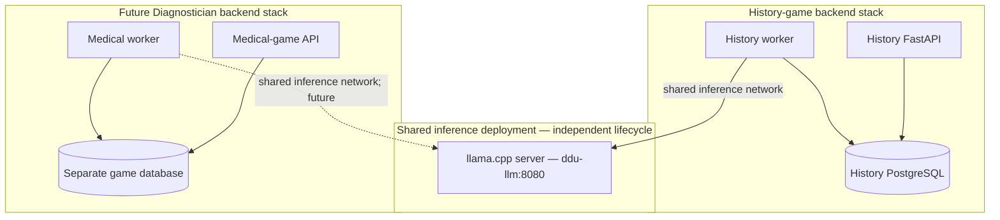

# IdeHistorieCase — Next Development Step
## M1.5: Validate GPU inference and prove reuse across independent game backends

**Date:** 28 October 2026  
**Repository:** [MarcusFunt/IdeHistorieCase](https://github.com/MarcusFunt/IdeHistorieCase)  
**Reviewed baseline:** `main` at [`f524f5e`](https://github.com/MarcusFunt/IdeHistorieCase/commit/f524f5e5694c87b87fe36905dac0e3648c0e806d)  
**Suggested branch:** `feat/m1-5-shared-inference-validation`  
**Priority:** Do this before adding RAG, speech, or extensive gameplay features.  
**Deliverable:** One focused pull request plus a reproducible, sanitized host-validation record.

---

## 1. Objective and rationale

**Prove that the current llama.cpp inference service can stay running independently and reliably serve multiple, independent applications—starting with the history game and, later, a medical-diagnostics game (Diagnostician).**

The current repository already has the right basic separation:

- `ddu-inference`: one Docker Compose deployment hosting llama.cpp and a user-provided GGUF model.
- `ddu-backend`: a separate Docker Compose deployment hosting PostgreSQL, FastAPI, and a monitoring worker.
- `ddu_inference_bus`: a shared, externally created Docker network; only the history game's worker joins it, not its API or database.
- An OpenAI-compatible llama.cpp `/v1/chat/completions` API that can be called from more than one application.

**Important distinction:** The history-specific Versailles prompt in `backend/app/ai/llm.py` is in the *history application backend*, not hardcoded into llama.cpp itself. It does **not** prevent a future medical backend from using the same inference service. Avoid premature extraction of a general Python library or rewriting everything into a new service.

### Intended topology



The inference stack should handle **model execution**, not session ownership, historical facts, medical ground truth, retrieval documents, grading, or game-state transitions. Those belong to their respective application backends.

---

## 2. Confirmed state vs. unverified assumptions

### Confirmed from the repository

- M1 implementation and follow-up fixes are merged into `main`.
- GitHub Actions passed at baseline `f524f5e`, including Python checks, PostgreSQL migration/integration tests, Compose validation, and a backend-only boot with inference deliberately absent.
- The history worker polls the model's `/health` endpoint and records a PostgreSQL heartbeat.
- `/healthz` and `/readyz` remain independent of inference availability, while `/api/v1/status` reports inference as `degraded` or `ready` based on the latest valid heartbeat.
- A Danish, strict-JSON probe exists at `python -m app.workers.probe`.

### Not yet demonstrated

- Real GGUF loading and completion generation on the target NVIDIA GPU.
- The selected llama.cpp image and model's chat-template/structured-output compatibility on that host.
- Independent use by a *second* client that does not import the history backend's code.
- Measured GPU VRAM footprint, latency, cold-start timing, and coexistence with other workloads (including AI-Stack).
- Failure/recovery behavior when two distinct clients are involved.

**Do not label M1.5 complete based solely on green CI.** GPU testing and the second-client check are manual host acceptance gates unless a suitable GPU runner is introduced later.

---

## 3. Scope: one tightly bounded milestone

### In scope

1. Run the actual inference stack on the intended GPU host using a deliberate, versioned GGUF selection.
2. Establish a documented and tested application-neutral HTTP contract for model calls.
3. Test two different clients or workloads against one running model without duplicate model containers.
4. Verify the history backend can be stopped/restarted independently of inference.
5. Measure model readiness, generation performance, peak VRAM and simple two-client contention.
6. Improve only the error handling and configuration that these tests demonstrably require.
7. Store redacted test evidence and add a concise guide for connecting a future game backend.

### Out of scope

- Building the complete Diagnostician backend or frontend.
- Medical RAG, patient records, medical accuracy, clinical decision support, or real patient information.
- Implementing history-game sessions, a turn queue, deterministic gameplay or Godot UI in this PR.
- Adding STT, TTS, embeddings, rerankers or complex model routing.
- Renaming or moving Docker projects for aesthetic reasons.
- Dynamically swapping models. Start with **one resident model**; do not create a second heavyweight GPU copy.

---

## 4. Implementation tasks (in order)

### Task A — Freeze a testable baseline

- [ ] Record current `main` SHA, Docker Engine/Compose versions, GPU model, NVIDIA driver, Container Toolkit version and host OS.
- [ ] Confirm GitHub Actions are green before changes.
- [ ] Inspect the model directory and **avoid changing or shutting down other AI-Stack services without an explicit operational reason**.
- [ ] Create the feature branch for this milestone.

Suggested files to inspect before editing:

- `deployment/inference/compose.yaml`
- `deployment/inference/.env.example`
- `deployment/backend/compose.yaml`
- `backend/app/ai/llm.py`
- `backend/app/workers/probe.py`
- `scripts/m1_smoke.sh`
- `docs/M1_RUNBOOK.md`

### Task B — Execute the existing real-model acceptance test

From the repository root on the Docker host:

```bash
# Ensure the shared network exists; this must not touch AI-Stack networks.
docker network inspect ddu_inference_bus >/dev/null 2>&1 || \
  docker network create ddu_inference_bus

# First-time setup only; inspect and edit both .env files before deployment.
cp -n deployment/inference/.env.example deployment/inference/.env
cp -n deployment/backend/.env.example deployment/backend/.env

# Confirm the two Compose files are valid.
docker compose -f deployment/inference/compose.yaml \
  --env-file deployment/inference/.env config --quiet

docker compose -f deployment/backend/compose.yaml \
  --env-file deployment/backend/.env config --quiet

# Start inference on its own first.
docker compose -f deployment/inference/compose.yaml \
  --env-file deployment/inference/.env up -d

# Once inference is ready, start the independent backend.
docker compose -f deployment/backend/compose.yaml \
  --env-file deployment/backend/.env up -d --build

# Run the existing end-to-end smoke checks.
bash scripts/m1_smoke.sh
```

**Before starting:** Set `LLM_MODELS_DIR` and `LLM_GGUF_FILE` to a real compatible model, and replace the placeholder PostgreSQL password. The optional `scripts/download_m1_model.sh` in the repository downloads a pinned starter GGUF, but model download is not required if you already have a compatible file. Validate available GPU memory and the installed CUDA container runtime first.

If a test fails, collect the precise command, response, logs, environment *without secrets*, and reproducible steps. Fix the specific failure instead of obscuring it with a mocked success or a silent fallback.

### Task C — Prove that the HTTP interface is shared, not history-specific

Add a small smoke-test client, suggested path:

`tests/shared_inference_smoke.py` **or** `scripts/shared_inference_smoke.py`

Requirements:

- [ ] It must be standalone: **do not import `backend/app` or any history game code**.
- [ ] It accepts an inference URL and model alias using command-line arguments or environment variables.
- [ ] It sends two different synthetic requests to the **same** `/v1/chat/completions` server:
  - **Historical example:** A one-sentence Danish Versailles-era diplomatic response; schema `{"language":"da","reply":"..."}`.
  - **Medical-game infrastructure example:** A clearly fictional examination-interview response; schema `{"speaker":"examiner","reply":"..."}`. This tests protocol compatibility only, **not clinical quality**.
- [ ] The script validates HTTP status, response envelope, parseable JSON, required fields, types and nonempty content.
- [ ] It rejects truncation (`finish_reason` indicating token-budget exhaustion), unexpected schema fields, malformed output and empty answers.
- [ ] It applies a bounded timeout and returns a nonzero exit status on failure.
- [ ] It records elapsed time, model alias and success/failure, without logging personal data or private prompts.
- [ ] If the selected model supports a thinking toggle, pass it **per request**. Do not assume every model supports `chat_template_kwargs` or an identical chat template.

Execute this standalone client from an ephemeral container attached to `ddu_inference_bus`. For example, after the script exists:

```bash
docker run --rm \
  --network ddu_inference_bus \
  -v "$PWD:/work:ro" \
  -e LLM_BASE_URL=http://ddu-llm:8080 \
  -e LLM_MODEL_ALIAS=ddu-narrator \
  python:3.13-slim \
  python /work/scripts/shared_inference_smoke.py
```

This command is an **expected test entry point**, not a claim the script already exists. Implement the script with standard-library HTTP support (or explicitly install its dependencies in a reproducible test image) to make the command work as written.

After the two requests pass:

1. Stop only the history backend; repeat the standalone client test. **Inference must keep working**.
2. Start the history backend again; verify `/healthz`, `/readyz`, `/api/v1/status`, and the existing Danish probe.
3. Verify one inference model/container was serving both workloads.

**Future Diagnostician connection:** Put its own worker on `ddu_inference_bus` and configure `LLM_BASE_URL=http://ddu-llm:8080`. Keep its database, credentials, game state and case content outside that network. The shared Docker bridge is **not** a strong multi-tenant security boundary; connect only trusted local applications.

### Task D — Clarify the client abstraction, with minimal refactoring

The llama.cpp server already exposes a general API. Refactor the history backend only if it improves testing and actual reuse:

- [ ] Keep an application-neutral transport method (for example `complete(messages, response_schema, options)`) if the existing method becomes an obstacle.
- [ ] Keep `generate_danish_probe()` as a **history-specific wrapper** or diagnostic; it does not need to become a shared service.
- [ ] Keep `LLMProposal`/historical rule validation in the history game backend, not the inference deployment.
- [ ] Document the standard request fields used: `model`, `messages`, `response_format`, `max_tokens`, `temperature`, and optional model-specific template flags.
- [ ] Make application-specific generation settings configurable rather than fixing all future clients to 180 tokens or disabling reasoning globally.
- [ ] Add isolated tests covering model timeout, HTTP error, invalid JSON, schema violation and truncated completion where applicable.

**Do not extract a common Python package yet.** Shared HTTP protocol + two independent clients is sufficient evidence of reuse.

### Task E — Run a controlled reliability and capacity check

Record the following on the actual deployment host, with the selected model and quantization noted:

| Test | Evidence to collect | Pass condition |
|---|---|---|
| Inference-only startup | Container logs; `/health`; cold-start seconds | Model becomes ready without the backend |
| Real Danish probe | JSON response; exit code; elapsed time | Strict valid response, no truncation |
| Independent fictional-medical probe | JSON response; exit code | Second client succeeds without history code |
| History backend stopped | Container state and second-client result | Inference continues serving requests |
| Inference stopped | `/healthz`, `/readyz`, `/api/v1/status` after heartbeat interval | Backend remains available; inference becomes `degraded` |
| Inference restarted | Status before/after and time to ready | Worker reports `ready` again without backend restart |
| Back-to-back requests | Latency and GPU VRAM | No out-of-memory; both complete successfully |
| Two concurrent requests | Wall time and response validation | Both complete or fail clearly; no process crash |
| Port inspection | `docker compose ps` / host socket listing | No public PostgreSQL or model port |

Use a **single request at a time first** (`LLM_PARALLEL=1` is the current starting default). Concurrent clients may be serialized; do not claim true simultaneous GPU execution unless measured. Prefer queueing over model swapping or a second resident model. If AI-Stack runs on the same physical GPU, record VRAM contention and test conservatively.

### Task F — Publish reproducible evidence

Add a short file such as `docs/M1_5_VALIDATION.md` containing:

- Baseline and tested commit hashes.
- OS, GPU and Docker/NVIDIA runtime versions.
- Inference Docker image **digest**, model name, revision, quantization and SHA-256 (not the model weights).
- Commands executed and relevant non-sensitive output.
- A table of readiness time, generation latency, peak VRAM and failure/recovery observations.
- Two-client verification showing that inference remained available with the history backend stopped.
- Exact outstanding host limitations, if any.

Do not commit `.env` files, database passwords, tokens, patient data, GGUF weights or other unrelated AI-Stack artifacts.

---

## 5. Testing and pull-request acceptance criteria

A PR is **code-ready** when:

- [ ] Existing CI still passes.
- [ ] The standalone shared-inference test is committed, documented and runnable.
- [ ] HTTP contracts are testable independently from any history-game code.
- [ ] Both example workloads have strict output validation and negative tests.
- [ ] Compose isolation and private network/port assumptions have not regressed.
- [ ] No unnecessary extra inference container, duplicate model load or model hot-swapping dependency was introduced.
- [ ] Documentation explains how a future backend joins inference without joining the history database network.

M1.5 is **host-validated** only when:

- [ ] The actual NVIDIA host runs a GGUF model with the specified llama.cpp container.
- [ ] The existing real Danish probe passes.
- [ ] The second independent synthetic client passes against the same server.
- [ ] Stopping the history backend does not stop inference; stopping inference does not kill the history backend.
- [ ] Basic VRAM and latency measurements have been recorded.
- [ ] Evidence and known limitations are recorded in `docs/M1_5_VALIDATION.md`.

Do **not** substitute passing mocked/unit tests for the host-validation checklist. If GPU access is unavailable, merge a clearly marked **code-ready / GPU-unverified** PR only if that limitation is recorded and leaves the runtime gate open.

---

## 6. Technical guardrails for reuse by Diagnostician

1. **No game logic in the inference service.** A raw model completion is a proposal, never the authoritative source of game state.
2. **Separate data and state.** Diagnostician gets its own backend, database, permissions, case library, turn semantics and validation schemas.
3. **Fictional data only for the compatibility test.** Do not use real medical records or identify patients. A future medical use case requires its own privacy and safety design.
4. **Deterministic test results in the medical game.** Lab results, physical findings and diagnoses should originate from its authored case state; an LLM can verbalize allowed information but must not freely invent results.
5. **Controlled shared capacity.** One resident inference model is a reasonable starting point on the RTX 3060, but multiple apps can compete for throughput and context space. Benchmark before adding more consumers.
6. **Separate deployments remain separately restartable.** Model uptime must not depend on either game backend.
7. **No public inference endpoint.** Do not publish llama.cpp's `8080` port or attach untrusted services to the shared network.

Potential later evolution, **not part of M1.5**: a model router or multiple permanently resident inference services if measurements justify the extra VRAM and orchestration cost.

---

## 7. After M1.5: the next *feature* milestone (M2)

Once M1.5 passes, move on to the first **durable history-game turn** rather than expanding infrastructure again:

1. Add `game_sessions`, versioned scenarios and `turn_requests` tables with Alembic migrations.
2. Implement session-scoped authorization, expected-turn conflict checks and idempotent turn submission.
3. Create PostgreSQL-backed worker leasing/claiming with bounded retries and atomic game-state updates; do not hold a database transaction open during LLM calls.
4. Implement a deterministic fake inference provider so an entire test turn completes even if the shared inference stack is stopped.
5. Expose the minimum create-session / submit-turn / poll-result / resume-session API.
6. Unit-test duplicate submissions, worker crashes, malformed model proposals and deterministic replay.
7. Then build the simplest Godot Web interface to exercise that workflow; only afterward add RAG and real narrative generation.

**M2 exit condition:** A synthetic player creates a session, submits a turn, receives a durable result, refreshes/resumes, and cannot duplicate a game event by retrying. This works with the inference deployment stopped, using a deterministic fake provider.

---

## 8. Suggested GitHub issue / PR text

**Title:** `M1.5: Validate shared inference on GPU and support independent game clients`

**Description:**

> M1 infrastructure is merged and CI passes, but actual GGUF-on-GPU generation and reuse outside the history backend have not been demonstrated. This milestone adds a standalone two-workload HTTP smoke test, verifies independent Compose lifecycles and failure recovery, records real GPU/latency evidence, and documents how a future Diagnostician worker can reuse the same resident llama.cpp service without sharing application data or game rules. Keep changes small: no new permanent medical backend, no RAG, no audio, and no additional model copies. Mark GPU validation separately from CI verification.

**Definition of done:** Every code-ready and host-validated acceptance item in §5 is checked, or an explicit blocker remains open with supporting evidence.

---

## 9. Final recommendation

**Implement M1.5 as a small validation and interoperability milestone, not a redesign.** The existing separation is already appropriate. Demonstrate two independent clients talking to one genuinely running model, keep the deployments independent, and document measurable reliability and GPU limits. After that, invest in the history game's durable turn engine. The medical game can adopt the same shared inference service later without forcing the history game's backend, data or prompts into it.
