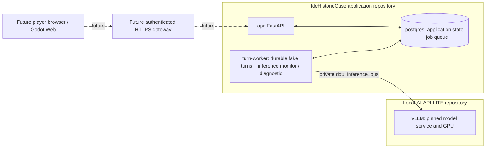

# Implementation plan: independently containerized AI educational history game

**Project:** DDU — educational history-of-ideas scenario game  
**Version:** 1.0, 27 October 2026  
**Status:** M0–M2 infrastructure and backend prototype implemented; M3–M9 remain proposed work; not classroom-ready
**Target:** One-developer MVP, local-first, browser-playable, Danish/English, 1–10 initial players  
**Key requirement:** The game's model inference must run in Docker **outside, and independently of, the existing AI-Stack Docker deployment**.

## 0. Executive decision and scope

**Implementation status (28 October 2026):** The external vLLM deployment and the application's M2 backend prototype have been implemented and accepted on the target host. This document now records the as-built boundary and evidence alongside a proposed roadmap; M2 is not a complete playable game or classroom deployment.

- **IdeHistorieCase application repository:** owns the API, PostgreSQL, migrations, durable turn queue, fake turn provider, worker health monitor, and its history-specific structured-output client and schema.
- **Local-AI-API-LITE repository:** independently owns the pinned vLLM service, model revision/cache, GPU configuration, independent synthetic workloads, benchmarks, and model lifecycle.
- The backend works with inference unavailable. `/healthz` reports process liveness; `/readyz` checks PostgreSQL; `/api/v1/status` reports worker and inference health separately. M2 turns use the deterministic fake provider.
- Only the backend `turn-worker` joins the private `ddu_inference_bus` network. The API and database do not, and the model service has no published host port.
- The Godot client, complete Versailles scenario, source-grounded RAG, production authentication, and classroom validation remain future work.

### Non-goals for the implemented M2 prototype

No complete game loop, continuously listening assistant, multiplayer negotiations, autonomous web ingestion, student grading for high-stakes decisions, external authentication provider, full historical corpus, always-on reranker, model hot swapping, or classroom-ready deployment. Focus future work on a complete, source-grounded Versailles teaching loop. Speech remains optional.

### Current acceptance snapshot

1. The vLLM service runs independently of the application backend, with no published model port. **Accepted on the target RTX 3060 host.**
2. The backend remains alive and database-ready with inference stopped; status degrades and recovers as the model stops and restarts. **Accepted on the target host.**
3. A deterministic, authenticated fake turn completes and replays without model inference. **Implemented and validated.**
4. The worker's real Danish diagnostic validates a strict application-owned JSON schema against the external model. **Accepted on the target host.**
5. No PostgreSQL or model port is published; the application API is loopback-bound. **Verified.**
6. Rollback to the original pinned llama.cpp image/model and return to vLLM work without resetting the backend database. **Tested on the target host.**
7. A student test demonstrates a learning objective with a complete game. **Not implemented.**

## 1. Architecture, deployment units and trust boundaries



| Boundary | Members | Purpose | Public? |
|---|---|---|---|
| Backend `data` network | `api`, `turn-worker`, `postgres` | Application queries, sessions and durable turns | No |
| Backend `ingress` network | `api` | Host-loopback API and future trusted gateway | API binds to host loopback |
| External `ddu_inference_bus` | `turn-worker` and the model service from Local-AI-API-LITE | Private cross-repository inference diagnostics | No host port publishing |
| Existing AI-Stack networks | AI-Stack services only | Unrelated deployments | DDU never joins |

The Docker bridge is a communication boundary, not a multi-tenant security boundary. Attach only trusted local services. The physical GPU remains a shared host resource and may contend with other workloads.

## 2. Repository structure and ownership

This application repository contains the FastAPI/PostgreSQL implementation under `backend/`, its backend-only Compose project under `deployment/backend/`, fake-turn smoke script, history-specific inference probe, and application documentation. It does not own model weights or model-serving infrastructure.

[Local-AI-API-LITE](https://github.com/MarcusFunt/Local-AI-API-LITE) is the separate repository for the vLLM Compose deployment, model download/cache, serving configuration, infrastructure smoke tests, synthetic workload benchmark, host runbook, and GPU measurements. Keep credentials and model weights outside both repositories.

The proposed Godot client, scenario content, RAG corpus, speech services, and future classroom gateway are not part of the current M2 implementation.

## 3. Deployment ownership and lifecycle

### 3.1 External inference service

The app repository no longer contains an inference Compose file or model download utility. Local-AI-API-LITE owns the pinned vLLM image, the `RedHatAI/Qwen3.5-4B-quantized.w4a16` model revision, GPU and serving limits, the model cache, and the current two-workload diagnostics. Follow that repository's runbook and benchmark record for model setup and lifecycle operations. The historical llama.cpp rollback and return to vLLM have also been exercised with the application database volume preserved.

Create or inspect the external Docker bridge `ddu_inference_bus` when preparing the host. Do not delete or recreate it while any attached service is running. The model port is not published to the host.

### 3.2 Application backend

The backend Compose project at `deployment/backend/compose.yaml` owns `postgres`, the one-shot `migrate` service, `api`, and `turn-worker`. The worker alone joins `ddu_inference_bus`; PostgreSQL and the API remain on the application networks. The current M2 turn provider is deterministic and does not call the model.

For backend-only development, follow the app repository [README](README.md) and [backend runbook](docs/M1_RUNBOOK.md). An external network object is required by Compose even when the model service is stopped, but fake turns work with inference absent.

### 3.3 Independent lifecycle

Start, stop, and update each project using the runbook in the repository that owns it. Stopping inference does not stop the backend or database. The worker heartbeat eventually reports inference as degraded; `/healthz` and database-backed `/readyz` stay healthy, and fake turns and replay continue to work. Restarting inference allows the worker monitor to report recovery without restarting the application.

### 3.4 Process health, readiness and inference status

- `/healthz` reports API process liveness independently of PostgreSQL and inference.
- `/readyz` returns 200 when PostgreSQL is accessible; inference health is deliberately not a readiness gate for the fake M2 flow.
- `/api/v1/status` reports database availability, worker heartbeat age, and inference state separately. It is a private diagnostic endpoint and must not be exposed publicly without authentication.

## 4. Runtime and GPU strategy (RTX 3060 12 GB target)

### 4.1 Model-serving options

| Workload | V1 default | Alternatives | When to change |
|---|---|---|---|
| Main LLM | External vLLM service, pinned image and model revision in Local-AI-API-LITE | SGLang or another separate service | Revisit only with model compatibility or measured performance evidence; keep ownership independent |
| Embeddings | Custom SentenceTransformers CPU-only API, EmbeddingGemma 2 text-only | Qwen3-Embedding-0.6B; TEI if model supported | Select using Danish retrieval accuracy + CPU latency, not benchmark reputation |
| ASR (optional) | Qwen3-ASR-0.6B in an independently built container | Other local ASR or hosted adapter | Choose after Danish WER and latency tests |
| TTS (optional) | Chatterbox Multilingual V3 container | Piper CPU fallback; alternative hosted TTS | Choose via Danish naturalness, speaker consistency, real-time factor and stability |
| Reranker (later) | No reranker | Lightweight cross-encoder, Qwen3 reranker | Add if top-k retrieval benchmarking proves improvement |

The active LLM profile is documented with image digest, model revision, context/concurrency settings, and host measurements in Local-AI-API-LITE. The remaining embedding, speech, and reranker choices below are proposed future work. The embedding service should load its chosen model once at process startup. Make it expose `POST /v1/embeddings` or a carefully documented dedicated embedding endpoint and return `model_id`, `dimension`, `vectors`, and request timing. Validate that vectors are finite, nonzero, and have the expected length. Use consistent query/document prefixes when required by the chosen model.

### 4.2 No continuous model swapping

Aim to keep the primary LLM fully GPU-resident. Keep the embedding model in CPU RAM, with speech models loaded only if the selected concurrency/memory configuration permits. CPU residency avoids GPU reload thrashing but can slow processing; benchmark it.

**Memory budgeting is a gating experiment, not a spreadsheet guarantee.** Measure with `nvidia-smi`, `docker stats`, and workload traces:

- Baseline idle host GPU memory before starting DDU.
- Model weight memory plus CUDA runtime and KV cache at context sizes 4096, then 8192 if feasible.
- A single game turn: initial token latency, tokens/sec, total generation time, peak VRAM.
- Two overlapping requests: actual throughput, latency and memory; only increase parallelism if it helps.
- ASR/TTS enabled: peak memory when all active workloads overlap.
- Existing AI-Stack concurrently running: determine whether there is an acceptable *shared GPU mode* at all. Docker GPU reservations do **not** guarantee exclusive VRAM slices or prevent oversubscription.

The current Qwen3.5 profile was measured at `max_model_len=4096` / `max_num_seqs=2` and `max_model_len=8192` / `max_num_seqs=4`, with `gpu_memory_utilization=0.75`; see the [Local-AI-API-LITE benchmark record](https://github.com/MarcusFunt/Local-AI-API-LITE/blob/main/docs/BENCHMARKS.md) for latency and VRAM evidence. These synthetic diagnostics do not establish full-game throughput. For future profiles, preserve observed VRAM headroom, cap response tokens, and measure p50/p95 generation and queue time before increasing concurrency.

### 4.3 Inference scheduler

For the first version, the `turn-worker` controls calls, with **one in-flight LLM generation per GPU** and bounded wait queues. Treat embedding queries as short tasks, with CPU serving to reduce GPU conflicts. Speech generation is lower priority than receiving the next text response and can be a separate optional job type. Add rate limits per session and global caps to avoid one student monopolizing the GPU.

Do not promise independent per-user real-time responses for 10 concurrent students on a single RTX 3060. Benchmark concurrent arrivals at 1, 2, 5, 10 users, and implement user-visible queue/wait states.

### 4.4 Platform setup: Windows + WSL2 + Docker Desktop

- Verify Docker Desktop's WSL2 Linux-container setup and GPU support: `docker run --rm --gpus all nvidia/cuda:12.9.0-base-ubuntu22.04 nvidia-smi` (check the selected CUDA image tag/host driver compatibility).
- Keep PostgreSQL on a Docker-managed Linux volume or other Linux filesystem, **not** a bind mount into NTFS via `/mnt/c` or `/mnt/d`; filesystem performance and reliability matter.
- Keep model snapshots in a persistent Docker-visible cache on a fast disk and verify cold-load time. The Local-AI-API-LITE service owns the current cache and snapshot lifecycle; do not copy weights into this application repository.
- Budget host RAM, disk, Docker's WSL virtual disk, cold startup time, and backup capacity. Storing a named volume in Docker Desktop's default data disk can consume C: even if model weights are elsewhere; plan disk placement and backup deliberately.

---

## 5. Application/API contracts and request processing

Sections 5–11 describe the proposed playable game, not the current M2 implementation. The M2 endpoints and narrower contracts are documented in the [README](README.md) and [M2 development guide](docs/M2_DEVELOPMENT.md).

### 5.1 API endpoints (versioned)

| Endpoint | Purpose | Typical response |
|---|---|---|
| `GET /healthz` | Liveness | 200 even if a model is down |
| `GET /readyz` | Database readiness | 200 when PostgreSQL is accessible; independent of inference health |
| `GET /api/v1/capabilities` | Show supported features | JSON booleans/availability |
| `GET /api/v1/scenarios` | Available scenarios | list |
| `GET /api/v1/scenarios/{slug}` | Roles, metadata, learning objectives | details |
| `POST /api/v1/sessions` | Start a new session | 201 + session token/state |
| `GET /api/v1/sessions/{id}` | Resume | latest committed state and pending job |
| `POST /api/v1/sessions/{id}/turns` | Submit free-text player turn | 202 + turn request ID and status URL |
| `GET /api/v1/turn-requests/{id}` | Poll turn lifecycle/result | pending/running/completed/failed |
| `GET /api/v1/sessions/{id}/turns` | History/replay | committed turns |
| `GET /api/v1/sources/{id}` | Full bibliographic source | approved passage + provenance |
| `POST /api/v1/speech/transcriptions` | Push-to-talk audio → editable text | optional |
| `POST /api/v1/speech/synthesis` | Text → voice audio | optional |

### 5.2 Asynchronous turn protocol (recommended)

**Create:**

```http
POST /api/v1/sessions/<session-id>/turns
Authorization: Bearer <session-scoped-token>
Idempotency-Key: 2d...uuid
Content-Type: application/json

{
  "client_turn_id": "2d...uuid",
  "expected_turn": 2,
  "text": "Erstatningsbetalinger bør følge Tysklands økonomiske evne.",
  "input_language": "da"
}
```

**Accept:** `202 Accepted`, `Location: /api/v1/turn-requests/<request-id>` with `{request_id, status: "queued", poll_after_ms: 1000}`. The server must authenticate and verify session ownership, idempotency and `expected_turn` before creating the request.

**Poll:** `GET /api/v1/turn-requests/<request-id>` returns states `queued`, `running`, `completed`, `failed`, or `cancelled` with a stable result snapshot if completed. Use bounded backoff rather than a rapid polling loop. Do not require the browser to keep one long HTTP request open while the LLM generates.

**Failure states:** `DEPENDENCY_UNAVAILABLE`, `MODEL_TIMEOUT`, `MODEL_BAD_OUTPUT`, `RAG_NO_EVIDENCE`, `SESSION_CONFLICT`, `RATE_LIMITED`, `INTERNAL_ERROR` mapped to appropriate status/result envelopes. Show contextual retry/replay options in Godot, not generic silent failure.

### 5.3 Turn lifecycle — durable state transitions

1. API transaction: check session token, lock the `game_sessions` row, check `expected_turn`, deduplicate `(session_id, client_turn_id)`, create `turn_requests(status='queued')`, commit quickly.
2. Worker selects jobs using PostgreSQL `FOR UPDATE SKIP LOCKED`, writes owner/lease/expiry, sets `running`, commits; never hold a SQL transaction across an LLM request.
3. Worker loads immutable scenario version, authoritative pre-turn state and history; obtains RAG evidence; assembles bounded prompt; calls inference service with a timeout.
4. Parse the model's JSON schema; validate speaker, citation IDs (must come from retrieved chunks), event allow-lists, ranges, phase transitions, and the educational distinction between historical fact, interpretation and counterfactual.
5. If invalid, perform at most one bounded repair request and then fail cleanly or use a deterministic fallback authored for that phase. Never accept arbitrary model replacement state.
6. Completion transaction: lock session, verify current turn still equals expected value, save model request/response metadata, retrieval snapshot, validated events and result, apply events exactly once, increment turn, update request to completed, commit atomically.
7. Any subsequent API retry for the same `(session_id, client_turn_id)` returns the same request/result. Repeated worker execution may consume additional **compute** after a crash, but must never duplicate a **committed state change**.
8. Expired leases are requeued with maximum attempt count and exponential backoff; failures remain inspectable.

For the MVP, allow only one outstanding turn per session. Additional submissions return `409 Conflict` plus the in-progress turn's ID. This is easy to explain and avoids racing historical consequences.

### 5.4 One canonical contract, three distinct shapes

- `LLMProposal`: `narration`, `speaker {character_id, utterance, emotion}`, `dilemma {prompt, learning_focus}`, `citations {chunk_id, claim}`, `proposed_events`, `historical_frame`.
- `ValidatedTurn`: typed proposal plus `accepted_events`, pre/post state, fixed scenario/prompt/model versions, evidence snapshot.
- `PublicTurnResult`: `speaker_id`, `utterance`, `narration`, `dilemma`, `sources`, UI indicators, formative evaluation, turn number.

The old report uses different LLM and API schemas; make **the transform explicit and covered by contract tests**. Never return raw private prompts or system instructions to the client.

### 5.5 Suggested Python conventions

Use Python 3.13 if supported by chosen model/driver libraries (the API and inference image environments can have **different Python versions**), FastAPI, Pydantic v2, SQLAlchemy 2 async + asyncpg, Alembic, httpx, pytest, Ruff and mypy. Use dependency injection around `InferenceClient` and `EmbeddingClient` so the backend tests use a deterministic fake model. Prefer explicit classes/functions over a large agent orchestration framework.

---

## 6. PostgreSQL schema and migrations

Split persistent concerns into conceptually separate table families:

**Game:** `scenario_versions`, `scenario_characters`, `game_sessions`, `turn_requests`, `committed_turns`, `game_events`, `turn_evaluations`.

**Evidence:** `source_documents`, `source_chunks`, `scenario_sources`, `embedding_models`, `chunk_embeddings_<model/dimension>` or per-dimension indexed table/partition, `turn_evidence`.

**Operations:** `worker_heartbeats`, `model_benchmarks` (optional), `audit_log` (minimal), `schema_migrations` managed by Alembic.

Key constraints:

- `(session_id, client_turn_id)` unique; `(session_id, turn_number)` unique for committed turns.
- Scenario references immutable `scenario_version_id`, not a mutable name; prompt version hash stored for replay.
- `turn_requests` has status, attempt count, leased-by, leased-until, created/updated, failure code and completed response reference.
- Use JSONB for flexible **bounded** game state, with Pydantic/schema checks before committing; use relational keys/constraints for identity and joins.
- Each `turn_evidence` reference stores exact source version, excerpt or content hash, rank and embedding model version. Later corpus re-ingestion must not rewrite the historical evidence shown in old sessions.
- Embeddings have a model ID + revision + dimension + preprocessing/instruction settings. **Do not force `vector(1024)` for all experiments**: EmbeddingGemma 2 can use 768, Qwen3-Embedding-0.6B up to 1024. Store separate indexed columns/tables by dimension; re-embedding should be a deliberate migration.
- Consider PostgreSQL `tsvector` lexical search, preserving phrase match, names, dates and Danish/English variants. Compare `'simple'`, Danish, and English configurations on real history-of-ideas queries rather than choosing solely by intuition.

### Retrieval and indices

Start **without HNSW** for a small curated corpus until exact-search speed is measured. Index `scenario_sources`, `source_chunks(document_id)`, suitable `tsvector` GIN, foreign keys, and `(session_id, turn_number)`. Exact vector search filtered to the scenario may be adequate and more reproducible. If HNSW becomes necessary, evaluate filtered recall: pgvector's approximate search can under-return after selectivity filters, and its iterative scans may help (https://github.com/pgvector/pgvector).

### Backups

Use `pg_dump -Fc` on a schedule (or a consistent higher-grade backup solution if the system becomes important), save **outside the container/volume**, encrypt if it contains learner data, and periodically restore into a fresh test instance. A named volume is persistence, **not** a backup. Restore testing is a release requirement, not a future nice-to-have.

---

## 7. Knowledge ingestion, RAG and grounded historical simulation

### 7.1 Corpus

Begin with a curated, small Versailles corpus of primary documents and credible secondary analysis. Track title, author, publication date, URL/book reference, license, source type, language, original page/section, full-text checksum, historical period, perspectives and scenario eligibility.

Preserve the distinction:

- **Historical fact:** grounded in source text.
- **Historical interpretation:** someone else's documented perspective, with attribution.
- **Counterfactual simulation:** possible game consequence, visibly not an event that actually happened.

Never let a student upload arbitrary text directly into the trusted historical knowledge base. Admin ingestion is a separate one-shot command/container with read/write privileges unavailable to the public API.

### 7.2 Offline ingestion sequence

`load document -> extract text -> normalize Unicode -> capture headings/page anchors -> preserve quotations -> chunk by heading/paragraph (start 350–700 tokens, overlap 60–100) -> calculate hashes -> embed in batches -> store model revision + document metadata -> run retrieval evaluations`.

Duplicate detection should be source-aware: repeated quotations in two sources may matter pedagogically. Keep source identity even if textual content is deduplicated for embedding cost.

### 7.3 Online retrieval per turn

1. Build deterministic query from scenario, player role, phase, concepts, and last argument; avoid querying solely with the player's sentence.
2. Filter to approved sources for this scenario *before* choosing final evidence.
3. Run semantic top-k and full-text top-k with recorded scores and ranks.
4. Fuse with reciprocal-rank fusion (RRF) or simple weighted ranking; start semantic 30 + lexical 30, then fuse and choose 6–8 diverse passages.
5. Remove redundant neighboring chunks; prefer documents representing important competing perspectives.
6. Render source IDs and excerpts in the LLM prompt as **untrusted evidence**, not instructions.
7. Accept only citations drawn from the exact retrieved set, and show bibliographic references via the Godot source panel.
8. If sources are absent or contradictory, make the limitation visible. Do not let the LLM invent historical citations.

### 7.4 Model selection experiment

Compare **EmbeddingGemma 2 text-only (270M loaded text component; 768d)** and **Qwen3-Embedding-0.6B (up to 1024d)** using 30–50 manually labeled Danish/English historical queries. Score Recall@5, MRR, nDCG@10, p50/p95 embedding latency on CPU, startup time, RAM, and multilingual robustness. EmbeddingGemma 2 has model-specific task prefixes and selective encoder-loading settings; follow the official model card: https://ai.google.dev/gemma/docs/embeddinggemma/model_card_2.

Do not introduce a reranker until this basic benchmark shows that the fused top results are regularly insufficient.

---

## 8. Deterministic game engine and pedagogy

The game must be a stateful historical negotiation/decision experience, not merely an open-ended chatbot.

### 8.1 Versailles MVP scenario

- **Scenario:** Paris Peace Conference, 1919.
- **Player role:** Britain initially; add France/United States after one playable role is robust.
- **Phases:** opening -> reparations -> border/security dilemma -> proposed settlement -> final reflection.
- **Actors:** a small verified roster of relevant historical delegations. Character presentation may dramatize responses, but factual claims need sources.
- **Learning objectives:** recognize tensions among security, self-determination and economic recovery; distinguish geopolitical interests from universal principles; argue using historical evidence; distinguish counterfactual play from factual history.
- **Bounded metrics:** `france_trust`, `us_support`, `economic_stability`, `security_guarantees`. Each has min/max, initial values, permitted delta and explanatory meaning.
- **Allowed events:** `adjust_metric`, `set_flag`, `advance_phase`; all validated by Python. Prefer applying events from a deterministic ruleset based on semantic classifications, not numerical values invented by the model alone.
- **End state:** negotiated outcome, not binary right/wrong victory; prompt a comparison with the historical treaty and a reflection on trade-offs.

### 8.2 Avoid conflating narrative consequences and learning assessment

A player may make a thoughtful argument and still upset a delegation. Compute:

1. **In-world consequences** (e.g., trust shifts and phase transitions) using explicit rules.
2. **Formative learning feedback** (historical context, evidence, perspective-taking, argument quality, consideration of consequences). Rubric-guided AI feedback may assist but should not be represented as objective or high-stakes grading.

Write each phase in YAML with objectives, initial state, permitted events, transition predicates, role-specific motivations, source allow-list and fallback dialogue. Changes should be testable and versioned.

### 8.3 Educational user testing

Pilot with 3–5 peers: task completion, engagement, whether they can distinguish fact/counterfactual, source usage, confusion points and observed learning. Record consent as appropriate, anonymize results, and iterate once before declaring the design complete.

---

## 9. Godot frontend and browser behavior

### UI scenes

`Main menu -> scenario/role selection -> gameplay -> source details -> consequences/feedback -> reflection/results`. Add resume, loading/queued state, timeout/retry, service-unavailable state, and explicit “historical simulation” labeling.

### State and networking

Godot's autoload `ApiClient` handles HTTPS, timeouts and response-code/error decoding; `SessionStore` mirrors the **last committed** game state but never authoritatively modifies it. Send `client_turn_id` and `expected_turn` with every turn. On startup, call `GET /sessions/{id}` to resolve any pending request and resume. Use nonblocking polling of `GET /turn-requests/{id}` while a turn is in progress. Show evidence citations in a dedicated source panel with origin, publication, and short excerpt.

### Speech/browser constraints

Start with text-only. In the optional phase add push-to-talk -> bounded audio file (e.g. 5–30 s) -> STT -> **editable transcript** -> ordinary text turn, then asynchronously request optional TTS for the returned character dialogue. If speech fails, retain the text response. Avoid storing raw microphone audio beyond the stated retention policy.

Test Godot's **exported Web build** early, not only the native desktop editor. Godot's web sample-audio playback has limitations for audio effects, and microphone access needs a secure browser context; see https://docs.godotengine.org/en/stable/tutorials/export/exporting_for_web.html. For Web microphone capture, validate the chosen Godot recording API end to end; if unusable, use a deliberately isolated JavaScript/browser capture bridge or ship text-only Web and speech in a native build.

### Deployment options

- Development: Godot editor/native + FastAPI through localhost/Tailscale Serve.
- Simple class build: static Godot Web on GitHub Pages; browser contacts an HTTPS API origin with strict CORS and session authentication.
- Lower operational complexity alternative: single HTTPS hostname/reverse proxy serving Godot static files and forwarding `/api/*` to the backend; avoid cross-origin browser issues.

Important: GitHub Pages **does not** forward API traffic to a private Tailscale address. Public students require a reachable authenticated API; Tailscale Serve alone only works for devices/users with suitable tailnet access. Do not make the inference bridge or DB public.

---

## 10. Authentication, privacy and abuse controls

- Prefer short-lived signed anonymous **session-scoped capability tokens** for a classroom pilot. Hash sensitive token identifiers at rest where appropriate; rotate signing keys carefully. Do not accept session UUIDs alone as authorization.
- Public endpoints require per-session/user/global rate limits, concurrency caps, prompt length limits, response limits, controlled audio MIME/size/duration, and ingress authentication if exposed beyond trusted testers.
- CORS allowlist only the actual Godot origin(s); CORS is not access control.
- The model cannot access SQL, shell, credentials, arbitrary URLs, or files. Treat player input and retrieved historical content as untrusted instructions, even when sources have been curated.
- Only session owners can read their sessions, turn status, sources that are permitted, and results. Test cross-session IDOR (insecure direct object references).
- Never ship database passwords, API secrets or model secrets to Godot Web. Keep DB on `data` only; model services only on `inference_bus`.
- Log durations, request IDs, error codes, session pseudonyms and model versions. Do **not** log raw learner text/audio by default; if research evaluation requires it, define consent, retention, and deletion procedures.
- For actual school deployment in Denmark, document personal-data handling, roles/responsibilities, processing purposes, access, retention and possible external AI transfers before accepting identifying learner data. Consult the school's process and Datatilsynet guidance.

---

## 11. Testing, observability and recovery

### 11.1 Test pyramid

| Layer | Essential tests |
|---|---|
| Python unit | pure state transitions, metric bounds, phase conditions, rubric, idempotency logic |
| Schema contract | all LLM JSON shapes and mapping into client responses; reject extra fields, unknown events/speakers/citations |
| DB integration | Alembic migration from empty database; queue leases; concurrent posts; duplicate submissions; rollback |
| Inference integration | model `/health`, timeouts, corrupted JSON, long outputs, 429/5xx, dependency down |
| Retrieval evaluation | 30–50 labeled queries, exact vs HNSW, hybrid vs semantic/lexical, citation allow-list |
| End-to-end | one full Versailles game in browser, refresh/resume, queue and timeout states, terminal reflection |
| Load | 1/2/5/10 concurrent users, p50/p95 queue/generation time, error rate and GPU RAM |
| Privacy/security | cross-session access, prompt injection in documents/player input, CORS, secret leak scan, no exposed DB/inference ports |
| Resilience | stop/restart `llm` mid-turn; stop backend mid-generation; database reconnect; worker lease recovery |
| Replay | stored committed run reconstructs same rendered narrative and deterministic final game state with all inference stopped |

### 11.2 Observability fields

`request_id`, `session_id` (pseudonymous), `turn_number`, `job_id`, `scenario_version`, `prompt_hash`, `retrieval_model`, `retrieval_latency_ms`, `retrieved_chunk_ids`, `llm_model`, `queue_wait_ms`, `llm_total_ms`, `validation_ms`, `ttft_ms` if available, `tokens_input/output`, `speech_ms`, `outcome`, `error_code`. Export simple structured JSON logs first. Optionally add OpenTelemetry/Prometheus once logs show diagnostic gaps.

Dashboards to prioritize: available model services, worker heartbeats, queue depth/oldest age, turn success rate, p95 latency, GPU VRAM/temperature, disk free, DB backup recency, inference container restarts. Alerting should be conservative and should not expose private game content.

### 11.3 Failure modes and intended behavior

| Failure | What the user sees | What software must do |
|---|---|---|
| LLM container stopped | “Game generation currently unavailable” | Keep session intact; retry with bounded backoff or offer replay |
| Embedding container stopped | “Historical source lookup unavailable” | Do **not** silently claim source-grounded facts; optional deliberate lexical-only fallback with honest disclosure |
| TTS fails | Dialogue remains readable | Disable voice playback for that turn only |
| Worker crashes | Request remains pending temporarily | Reclaim expired lease; no duplicate event commit |
| Browser refresh | Session resumes | Reconnect using persisted session credential and existing pending request |
| PostgreSQL restarts | Temporary request failure | Reconnect and avoid acting on uncommitted changes |
| GPU OOM | Graceful model service failure, not game-state corruption | Bound context/concurrency; worker marks retryable failure; revisit residency |
| AI-Stack starts concurrently | Possible VRAM contention | Detect and alert; isolate scheduling operationally, not by wishful Compose configuration |

**Backup/restore drill:** stop just the API/worker (not inference), create a consistent DB dump, initialize a fresh DB volume, restore, run migrations and a replay test. Record time to restore and what learner data is retained.

---

## 12. Milestones and engineering acceptance gates

The table separates the implemented prototype from the remaining game roadmap. Earlier hour estimates are planning ranges only; they are not completion claims.

| Stage | Work package | Status / exit gate |
|---|---|---|
| M0 | Repository setup, Docker GPU prerequisites and private network | **Accepted** on the target Windows/WSL2 host; NVIDIA GPU visibility verified. |
| M1 | Independent model service and structured Danish diagnostic | **Accepted** using Local-AI-API-LITE and its pinned vLLM/model profile. |
| M1.5 | Shared-inference prototype measurements | The older llama.cpp/GGUF measurements are preserved as historical evidence. Current vLLM measurements are in Local-AI-API-LITE. |
| M2 | Backend Compose, PostgreSQL migrations, health monitor and deterministic fake provider | **Implemented and validated**: authenticated fake turn, retry/idempotency, completion, resume and replay work without inference. This is a backend prototype, not a playable game. |
| M3 | Godot UI and async turn endpoint/poll/resume | **Proposed**: browser submits, reloads and replays a deterministic mock turn. |
| M4 | Deterministic scenario rules and complete Versailles text-only flow | **Proposed**: the game reaches reflection under a fake provider with fixed tests. |
| M5 | Embedding service, curated corpus, hybrid RAG and citation checks | **Proposed**: retrieval evaluation and no fabricated citation IDs. |
| M6 | Real LLM prompt adapter, schemas, bounded repair and error recovery | **Proposed**: real local full turn with no duplicate state changes. |
| M7 | Model/GPU benchmarks and 2–10 student load test | **Proposed**: select a stable profile and document limitations. |
| M8 | Authentication, trusted ingress, observability and backup/restore | **Proposed**: security and restore evidence. |
| M9 | Learner usability study and report iteration | **Proposed**: record feedback and an iterative improvement. |
| Optional | ASR, TTS, voice caching and browser audio | **Proposed**; speech can be disabled without blocking text gameplay. |

A credible technical showcase requires the future game, source corpus and evaluation work; classroom readiness also requires security, recovery and student validation. The current acceptance covers the inference foundation and M2 backend prototype only.

### Recommended issue / epic sequence

1. Docker separation and GPU smoke testing.
2. Backend API/database/worker Compose and migration scaffold.
3. Durable job lifecycle and idempotency/concurrency tests.
4. Godot Web vertical slice, reconnect and result panels.
5. Versailles source-verified content and deterministic state machine.
6. Embedding benchmarking, corpus ingestion and hybrid retrieval.
7. Real LLM JSON output, semantic validation and historical grounding.
8. End-to-end evaluation and operational/backup/security hardening.
9. Optional push-to-talk and TTS integration.

---

## 13. Decision records and tradeoffs

| Decision | Why | When to revisit |
|---|---|---|
| Separate application and inference repositories/Compose ownership | Independent lifecycle from each other and AI-Stack; only worker and model share the private network | If moved to different physical hosts; retain the logical service boundary |
| Separate LLM/embedding/speech containers | Isolate dependencies and compute | If deployment complexity demonstrably exceeds value |
| PostgreSQL job queue | Minimum extra infrastructure, atomic transaction semantics | If high-throughput fanout or many independent workers cause contention |
| vLLM in Local-AI-API-LITE | Pinned model-serving image, revision and measured GPU profile live outside the app repository | If compatibility or repeatable benchmarks justify another independently owned serving runtime |
| Embedding on CPU initially | Keep LLM VRAM resident | If measured query-embedding latency hurts UX and GPU headroom permits offload |
| Hybrid PostgreSQL search | Good for named entities, dates and conceptual retrieval | If corpus/index scale or ranking quality justifies additional service |
| No HNSW initially | Small filtered corpus may be faster/simpler via exact search | When query benchmark shows clear gain |
| Async turn job/poll rather than long HTTP | Resilience to browser timeouts, GPU queues and model downtime | If measured response times are consistently short and a simpler contract is justified |
| One outstanding turn/session | Prevent concurrent contradictory events | If genuine multi-player state concurrency is later required |
| Godot Web | Scene-based 2D game, existing skill, portable browser delivery | If UI becomes a conventional form-heavy web app |
| TTS optional | Learning game remains playable without expensive audio work | If voice proves pedagogically necessary in user tests |

---

## 14. Implementation record and next work

The original checklist is retained here as a project progress record:

- **Infrastructure and model service — complete:** GPU access, private external network, pinned vLLM image/model revision, host runbook, model health, alias check, structured Danish diagnostic, no published model port, benchmarks, lifecycle recovery, and a rollback to the original llama.cpp image/model without database reset were validated in Local-AI-API-LITE.
- **Backend minimum — complete for the M2 prototype:** isolated PostgreSQL/API/worker Compose services, migrations, heartbeat diagnostics, deterministic fake turn flow, and external-inference client/probe are implemented in this repository.
- **Durable turn behavior — implemented and covered:** capability-based sessions, idempotency, expected-turn conflicts, lease/retry handling, atomic completion, and replay.
- **Frontend, complete scenario, source grounding, and student evaluation — not started:** these remain the next product milestones. M2 does not yet provide the Versailles teaching loop.

### Next practical sequence

1. Build the Godot Web vertical slice and reconnect/replay interface.
2. Author and validate a complete Versailles scenario with deterministic state transitions.
3. Add a curated, licensed source corpus and evaluate retrieval and citation checks.
4. Integrate model output into the turn pipeline only with bounded, validated state proposals.
5. Harden authentication, retention, backups, recovery, ingress and classroom operations.
6. Evaluate learning outcomes with students and record evidence-driven revisions.

### Future project gates that must *not* be skipped

- Model supports quantized inference and schema-following *on this exact serving runtime*.
- Model revision and embedding dimensions are recorded in the DB; model changes cannot silently invalidate existing vectors.
- Empty-corpus and inference-down fallback states do not present fabricated history as sourced truth.
- Actual Godot Web export is tested before promising microphone support.
- Backend/inference startups are independent and never require bringing AI-Stack up or down.
- A test restores the DB and replays a session from persistent data without AI.

---

## 15. Deliverables for the DDU report

Tie technical work to the school's project documentation: *indledning, problemidentifikation, problemanalyse, problemformulering, produktprincip, tekniske problemstillinger, kravspecifikationer, projektafgrænsning*. For the process report, record requirements, reasons for software choices, flowcharts, iterative prototypes, project management, IT security, production, quality assurance, user feedback, and conclusion.

Produce inspectable evidence as the project advances: architecture diagram, container network diagram, one full request/turn sequence, Docker configuration exports without secrets, unit/integration test results, RAG recall experiment, GPU latency/VRAM table, versioned screenshots of UI changes, anonymized feedback from testers and acceptance against hard/soft requirements.

Possible technical problem questions: (1) how to preserve deterministic game state with nondeterministic LLM dialogue; (2) how to ground historical response in a curated RAG corpus; (3) how to operate multiple inference models with limited VRAM and independent Docker lifecycles; (4) how to deliver a usable game to browsers with a private backend; (5) how user testing changes the game's learning feedback; (6) how failures, authentication and privacy are handled.

---

## 16. Primary technical documentation and source lineage

**Source-derived from the previously provided architecture report:** Godot/FastAPI/PostgreSQL/pgvector split, deterministic event validation, source-grounded hybrid RAG, browser access through Serve/Funnel, scenario YAML, source/rubric evaluation and test categories. The earlier report's exact model recommendations and raw schema have been *revised* in this plan rather than blindly copied. Original user-provided file: `deep-research-report (9).md`.

**Independent technical references verified on 27 October 2026.** The llama.cpp links below support only the historical M1.5 baseline; vLLM in Local-AI-API-LITE is the current serving implementation.

- Docker — cross-project external networks: https://docs.docker.com/compose/how-tos/networking/
- Docker — Compose GPU service reservations: https://docs.docker.com/compose/how-tos/gpu-support/
- Docker — PostgreSQL volume setup (including v18 path): https://docs.docker.com/guides/postgresql/
- llama.cpp — official Docker image variants: https://github.com/ggml-org/llama.cpp/blob/master/docs/docker.md
- llama.cpp — OpenAI-compatible server and readiness endpoint: https://github.com/ggml-org/llama.cpp/blob/master/tools/server/README.md
- pgvector — vector indexing and filtered query behavior: https://github.com/pgvector/pgvector
- Google — EmbeddingGemma 2 selective text-only loading and dimensions: https://ai.google.dev/gemma/docs/embeddinggemma/model_card_2
- Resemble AI — Chatterbox Multilingual/Danish: https://github.com/resemble-ai/chatterbox
- Godot — Web export/audio constraints: https://docs.godotengine.org/en/stable/tutorials/export/exporting_for_web.html

**Verification note:** The backend Compose project was validated and the backend was exercised with inference both available and stopped on the target host. The current pinned vLLM image/model profile and GPU benchmarks are recorded in Local-AI-API-LITE. The game, scenario, retrieval and classroom sections remain proposed work and still require their own implementation and acceptance evidence.
