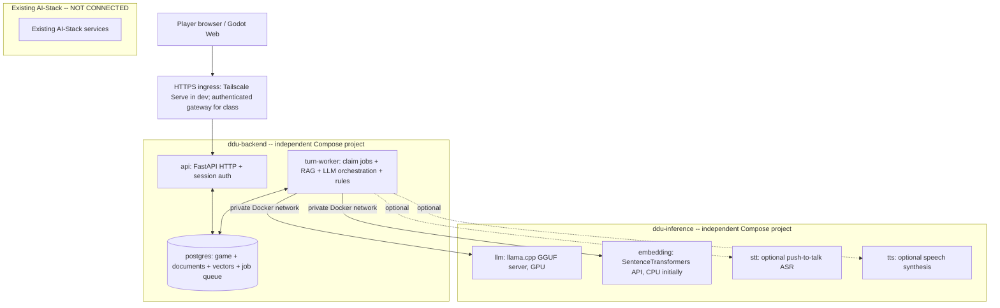

# Implementation plan: independently containerized AI educational history game

**Project:** DDU — educational history-of-ideas scenario game  
**Version:** 1.0, 27 October 2026  
**Status:** Detailed engineering plan / proposed design, not a claim of completed implementation  
**Target:** One-developer MVP, local-first, browser-playable, Danish/English, 1–10 initial players  
**Key requirement:** The game's model inference must run in Docker **outside, and independently of, the existing AI-Stack Docker deployment**.

## 0. Executive decision and scope

Retain the original report's core principle: **Godot renders the game; FastAPI and deterministic Python rules control the application; PostgreSQL stores truth and evidence; an LLM proposes dialogue and bounded game events, never directly changes state.** The new design strengthens container and failure boundaries:

- **`ddu-backend` Compose project:** `api`, `turn-worker`, `postgres`; later optional `ingest-job`, `backup`, and `metrics`/reverse proxy. It works even if inference is down, returning a truthful dependency-unavailable status or replaying previously committed sessions.
- **`ddu-inference` Compose project:** at minimum `llm` and `embedding`; later independently switchable `stt`, `tts`, `reranker`. No dependency on AI-Stack images, networks, databases, secrets, or Compose lifecycle.
- **Godot 4 frontend:** web build on GitHub Pages initially, or served via the same HTTPS gateway as the backend if cross-origin deployment is inconvenient.
- **Independent controls:** `docker compose -p ddu-inference ... up/down` has no lifecycle effect on `ddu-backend`; the reverse is also true. Each inference container can restart independently. They communicate across one explicitly created **external Docker bridge network**.
- **Do not add Kubernetes, Redis, Celery, RabbitMQ, LangChain, or a separate vector database by default.** Each is a future option only if there is measurable need. A PostgreSQL-backed job table is enough for the first low-throughput game.
- **Existing AI-Stack:** completely optional and uninvolved. Its Docker networks and services must never be a required dependency. Because both use the same physical GPU, simultaneous execution can still compete for VRAM; isolation at the Compose level does *not* imply GPU memory partitioning.

### Non-goals for the first playable milestone

No continuously listening assistant, multi-user multiplayer negotiations, autonomous internet ingestion, student grading for high-stakes decisions, complicated authentication provider, giant historical corpus, always-on reranker, dynamic model hot swapping, or 10+ scenarios. Focus on one complete Versailles teaching loop. Speech is an enhancement, not a critical dependency.

### Success criteria

1. A browser opens the game, creates a session, selects a role, reads a dilemma, sends an argument, and receives a validated response with at least one usable source reference.
2. The turn survives browser refresh; repeat submission with the same idempotency key produces no duplicate game event.
3. `ddu-inference` can run with `ddu-backend` stopped, and `ddu-backend` remains operational in a reduced-capability state with inference stopped.
4. No PostgreSQL or model port is published to the public internet. The only externally accessible application endpoint is the authenticated game API/reverse proxy.
5. Replaying a stored turn does not require an AI model or network access.
6. A documented student test demonstrates an actual learning objective, not merely believable historical dialogue.

---

## 1. Architecture, deployment units and trust boundaries



**Network boundaries:**

| Network | Members | Purpose | Public? |
|---|---|---|---|
| `ddu_backend_data` (backend project's `data` network; `internal: true`) | `api`, `turn-worker`, `postgres` | Database/query and job operations | No |
| `ddu_backend_ingress` (backend local bridge) | `api` | Access the API via host loopback / trusted reverse proxy | Only through explicit gateway |
| `ddu_inference_bus` (external network created once) | `turn-worker`, `llm`, `embedding`, optional speech services | Cross-Compose service discovery and inference requests | No; no port publishing |
| AI-Stack's existing networks | AI-Stack services only | Unrelated deployments | Never joined by DDU |

**Security nuance:** A shared Docker bridge network is a communication boundary, not a full zero-trust service-mesh. Do not attach arbitrary unrelated containers to `ddu_inference_bus`. Add internal model API authentication if untrusted workloads ever share the Docker host/network.

### Why two Compose projects, not one giant Compose file?

Independent startups, deployment cycles, model upgrades, restart policies, logs, model storage and GPU lifecycle. Backend can be tested with a fake provider without mounting model weights. Inference can be benchmarked using diagnostic containers without touching a live educational session.

### Why multiple inference containers rather than one enormous inference container?

Use one *logical* inference deployment, but one container **per incompatible runtime or model workload**. The LLM, embedding, ASR and TTS libraries often have differing Python/CUDA requirements. Combining all into a single image increases dependency conflict, startup time and crash blast radius. You can run all of them as `ddu-inference`, or run only selected profiles. If your requirement is literally one inference container, start with `llm` alone and add the others; do not sacrifice isolation just to achieve a single image.

---

## 2. Repository structure and ownership

```text
ddu-history-game/
├── godot/
│   ├── project.godot
│   ├── export_presets.cfg
│   ├── scenes/{main_menu,scenario_select,gameplay,source_viewer,results}.tscn
│   ├── autoload/{api_client,session_store,scene_router}.gd
│   └── scripts/{dialogue_view,dilemma_input,source_panel,audio_capture}.gd
├── backend/
│   ├── pyproject.toml
│   ├── Dockerfile
│   ├── alembic.ini
│   ├── migrations/
│   ├── app/
│   │   ├── main.py
│   │   ├── api/{auth,scenarios,sessions,turns,sources,health}.py
│   │   ├── game/{state,rules,engine,rubric,schemas}.py
│   │   ├── jobs/{models,repository,leases}.py
│   │   ├── workers/{main,turn_pipeline}.py
│   │   ├── rag/{ingest,chunking,lexical,semantic,fusion,evidence}.py
│   │   ├── ai/{interfaces,local_llm,embedding_client,structured_validation}.py
│   │   ├── db/{session,models,queries}.py
│   │   └── core/{settings,security,telemetry}.py
│   └── tests/{unit,integration,contracts,e2e,evals}/
├── inference/
│   ├── embedding/{Dockerfile,requirements.lock,main.py}
│   ├── speech-asr/{Dockerfile,main.py}       # optional phase
│   ├── speech-tts/{Dockerfile,main.py}       # optional phase
│   └── README.md
├── content/
│   ├── scenarios/versailles-1919/{scenario.yaml,rubric.yaml,characters.yaml}
│   ├── source-manifest.yaml
│   └── prompts/{narrator,evaluator}.jinja2
├── deployment/
│   ├── backend/{compose.yaml,.env.example}
│   ├── inference/{compose.yaml,.env.example}
│   └── gateway/  # optional Caddy config / Serve notes
├── scripts/{init_network.sh,smoke_test.sh,backup_db.sh,restore_db.sh}
├── docs/{architecture,api-contracts,operations,security,model-benchmarks}.md
└── .github/workflows/{backend-ci,frontend-ci,inference-smoke}.yaml
```

**Version everything:** Docker image digests (after proving a version works), Python lockfiles, Godot editor/export template version, model repository/revision, GGUF file checksum, embedding model/dimension, YAML scenario revision, and prompt hash. Record these identifiers with every generated turn; don't depend on mutable `latest` tags in deployment.

---

## 3. Docker Compose blueprint: networking and lifecycle

Create the one cross-project network once:

```bash
docker network create --driver bridge ddu_inference_bus
```

If the network already exists, inspect it; do not blindly delete/recreate a network while services are using it. Docker Compose documents external networks specifically for inter-project communication: https://docs.docker.com/compose/how-tos/networking/.

### 3.1 `deployment/inference/compose.yaml` — initial LLM container

The following is an **illustrative starter configuration**, not a promise of a fully installed game. It assumes that `${LLM_MODELS_DIR}` contains `${LLM_GGUF_FILE}`, and that NVIDIA Docker GPU support has been tested. The embedding and speech services are added in later phases; see their contracts below.

```yaml
name: ddu-inference
services:
  llm:
    image: ghcr.io/ggml-org/llama.cpp:server-cuda
    restart: unless-stopped
    command:
      - --model
      - /models/${LLM_GGUF_FILE}
      - --host
      - 0.0.0.0
      - --port
      - '8080'
      - --ctx-size
      - ${LLM_CTX_SIZE:-4096}
      - --n-gpu-layers
      - ${LLM_GPU_LAYERS:-99}
      - --parallel
      - ${LLM_PARALLEL:-1}
      - --alias
      - ddu-narrator
    volumes:
      - ${LLM_MODELS_DIR:?Set LLM_MODELS_DIR}:/models:ro
    networks:
      inference_bus:
        aliases: [ddu-llm]
    deploy:
      resources:
        reservations:
          devices:
            - driver: nvidia
              count: 1
              capabilities: [gpu]

networks:
  inference_bus:
    external: true
    name: ddu_inference_bus
```

No `ports` mapping: the container listens on its Docker network only. `--parallel=1` and `--ctx-size=4096` are conservative **starting experiments**, not final performance recommendations. Verify GPU offload, available KV cache, and real Danish generation quality; revise only after testing. The llama.cpp project documents both the `server-cuda` image and schema-constrained HTTP API: https://github.com/ggml-org/llama.cpp/blob/master/docs/docker.md and https://github.com/ggml-org/llama.cpp/blob/master/tools/server/README.md.

**Later inference services:** Each service joins the same `inference_bus` with a unique alias: `ddu-embedding`, `ddu-stt`, `ddu-tts`. Place `stt` and `tts` in Compose `profiles: [speech]`. The worker discovers them through DNS and config; the backend never depends on speech being available to process text turns. Container images for these services must be built, pinned, and tested before adding them to the deployment file.

### 3.2 `deployment/backend/compose.yaml` — API, worker, PostgreSQL

This is the intended service topology; `api` and `turn-worker` builds only become runnable when the backend implementation described below exists:

```yaml
name: ddu-backend
services:
  postgres:
    image: pgvector/pgvector:0.8.7-pg18-trixie
    restart: unless-stopped
    environment:
      POSTGRES_DB: ddu_game
      POSTGRES_USER: ddu_app
      POSTGRES_PASSWORD: ${POSTGRES_PASSWORD:?Set POSTGRES_PASSWORD}
    volumes:
      - pgdata:/var/lib/postgresql
    networks: [data]
    healthcheck:
      test: ['CMD-SHELL', 'pg_isready -U ddu_app -d ddu_game']
      interval: 10s
      timeout: 5s
      retries: 10

  api:
    build:
      context: ../../backend
    command: ['uvicorn', 'app.main:app', '--host', '0.0.0.0', '--port', '8000']
    restart: unless-stopped
    env_file: .env
    environment:
      DATABASE_HOST: postgres
    depends_on:
      postgres:
        condition: service_healthy
    ports:
      - '127.0.0.1:8000:8000'
    networks: [data, ingress]

  turn-worker:
    build:
      context: ../../backend
    command: ['python', '-m', 'app.workers.main']
    restart: unless-stopped
    env_file: .env
    environment:
      DATABASE_HOST: postgres
      LLM_BASE_URL: http://ddu-llm:8080/v1
      EMBEDDING_BASE_URL: http://ddu-embedding:8090
    depends_on:
      postgres:
        condition: service_healthy
    networks: [data, inference_bus]

volumes:
  pgdata:

networks:
  data:
    internal: true
  ingress: {}
  inference_bus:
    external: true
    name: ddu_inference_bus
```

**PostgreSQL 18 volume caveat:** For PostgreSQL 18 the persistence mount is `/var/lib/postgresql`, not the older `/var/lib/postgresql/data`; see https://docs.docker.com/guides/postgresql/.

**Important production corrections to the illustration:** Use long random secrets loaded via an appropriate protected secret mechanism. The DB application role should not remain a migration superuser; migrate with a dedicated privileged role, then use least-privileged runtime credentials. Pin image digests when qualified. Configure backups, resource limits, log rotation, HTTP timeouts, production TLS, and environment-specific DNS explicitly. The code referenced by `build` does not exist merely because this plan defines its expected paths.

### 3.3 Independent startup and shutdown

```bash
# First time, once:
docker network create ddu_inference_bus

# Models can run when the backend is fully stopped:
docker compose -f deployment/inference/compose.yaml \
  --env-file deployment/inference/.env up -d llm

# Backend remains a separate deployment:
docker compose -f deployment/backend/compose.yaml \
  --env-file deployment/backend/.env up -d postgres api turn-worker

# Stop inference without stopping database/API:
docker compose -f deployment/inference/compose.yaml down

# Or stop only worker + API without stopping inference:
docker compose -f deployment/backend/compose.yaml stop api turn-worker
```

If executing from another working directory, explicitly set `--project-directory` as needed, and validate Compose's interpolated config before starting: `docker compose -f <file> --env-file <file> config`. **Do not run `docker compose down -v` as a routine stop command**; `-v` can delete database volumes.

To test inference without the backend, run a disposable diagnostics container attached to the same bridge:

```bash
docker run --rm --network ddu_inference_bus \
  curlimages/curl:latest -fsS http://ddu-llm:8080/health
```

For a live deployment, pin the diagnostics image too. The test should return HTTP 200 only once the model is loaded; health may return 503 while loading.

### 3.4 Process health vs readiness

- `/healthz` (API): process responds and event loop is alive, even when inference is down.
- `/readyz` (API): authenticated application can safely accept normal gameplay turn requests; checks DB and worker availability, and reports inference as **degraded** or unavailable separately.
- `llm /health`: ready when weights loaded; do not mistake a running container for model readiness.
- Embedding `/health` and `/ready`: report model ID, dimension, loaded state, and compute device.
- Worker heartbeat: DB record of last healthy poll plus active-lease count. A live API and live database do not prove that pending turns are being processed.
- Aggregate `/api/v1/capabilities`: `{text_generation, retrieval, speech_input, speech_output, replay}` to drive Godot's available UI controls.

**Design constraint:** `depends_on` cannot span independent Compose projects. This is *intentional*: startup order is not a correctness requirement. Use runtime retries, backoff, bounded timeouts and explicit degraded states.

---

## 4. Runtime and GPU strategy (RTX 3060 12 GB target)

### 4.1 Model-serving options

| Workload | V1 default | Alternatives | When to change |
|---|---|---|---|
| Main LLM | llama.cpp `llama-server` CUDA + one GGUF, one model/container | vLLM, SGLang, Ollama as a separate container | Change if throughput/structured output/model support measurements justify it |
| Embeddings | Custom SentenceTransformers CPU-only API, EmbeddingGemma 2 text-only | Qwen3-Embedding-0.6B; TEI if model supported | Select using Danish retrieval accuracy + CPU latency, not benchmark reputation |
| ASR (optional) | Qwen3-ASR-0.6B in an independently built container | Other local ASR or hosted adapter | Choose after Danish WER and latency tests |
| TTS (optional) | Chatterbox Multilingual V3 container | Piper CPU fallback; alternative hosted TTS | Choose via Danish naturalness, speaker consistency, real-time factor and stability |
| Reranker (later) | No reranker | Lightweight cross-encoder, Qwen3 reranker | Add if top-k retrieval benchmarking proves improvement |

The embedding service should load its chosen model once at process startup. Make it expose `POST /v1/embeddings` or a carefully documented dedicated embedding endpoint and return `model_id`, `dimension`, `vectors`, and request timing. Validate that vectors are finite, nonzero, and have the expected length. Use consistent query/document prefixes when required by the chosen model.

### 4.2 No continuous model swapping

Aim to keep the primary LLM fully GPU-resident. Keep the embedding model in CPU RAM, with speech models loaded only if the selected concurrency/memory configuration permits. CPU residency avoids GPU reload thrashing but can slow processing; benchmark it.

**Memory budgeting is a gating experiment, not a spreadsheet guarantee.** Measure with `nvidia-smi`, `docker stats`, and workload traces:

- Baseline idle host GPU memory before starting DDU.
- Model weight memory plus CUDA runtime and KV cache at context sizes 4096, then 8192 if feasible.
- A single game turn: initial token latency, tokens/sec, total generation time, peak VRAM.
- Two overlapping requests: actual throughput, latency and memory; only increase parallelism if it helps.
- ASR/TTS enabled: peak memory when all active workloads overlap.
- Existing AI-Stack concurrently running: determine whether there is an acceptable *shared GPU mode* at all. Docker GPU reservations do **not** guarantee exclusive VRAM slices or prevent oversubscription.

Suggested initial targets for validation (not guaranteed performance): leave at least about 1–2 GiB observed GPU headroom under sustained load, try `LLM_PARALLEL=1`, and cap response token counts. Measure p50/p95 total turn latency and queue time. A 9B model in 4-bit may still exceed comfortable 12 GB limits once context/KV and speech are included; fall back to a smaller quantized model if needed.

### 4.3 Inference scheduler

For the first version, the `turn-worker` controls calls, with **one in-flight LLM generation per GPU** and bounded wait queues. Treat embedding queries as short tasks, with CPU serving to reduce GPU conflicts. Speech generation is lower priority than receiving the next text response and can be a separate optional job type. Add rate limits per session and global caps to avoid one student monopolizing the GPU.

Do not promise independent per-user real-time responses for 10 concurrent students on a single RTX 3060. Benchmark concurrent arrivals at 1, 2, 5, 10 users, and implement user-visible queue/wait states.

### 4.4 Platform setup: Windows + WSL2 + Docker Desktop

- Verify Docker Desktop's WSL2 Linux-container setup and GPU support: `docker run --rm --gpus all nvidia/cuda:12.9.0-base-ubuntu22.04 nvidia-smi` (check the selected CUDA image tag/host driver compatibility).
- Keep PostgreSQL on a Docker-managed Linux volume or other Linux filesystem, **not** a bind mount into NTFS via `/mnt/c` or `/mnt/d`; filesystem performance and reliability matter.
- Large model GGUF files may reside on a separate fast disk (e.g. D:) if mounted reliably into Docker, but verify model load times. A container's `:ro` mount protects the weights against accidental modifications.
- Budget host RAM, disk, Docker's WSL virtual disk, cold startup time, and backup capacity. Storing a named volume in Docker Desktop's default data disk can consume C: even if model weights are elsewhere; plan disk placement and backup deliberately.

---

## 5. Application/API contracts and request processing

### 5.1 API endpoints (versioned)

| Endpoint | Purpose | Typical response |
|---|---|---|
| `GET /healthz` | Liveness | 200 even if a model is down |
| `GET /readyz` | Readiness/degraded status | structured health components |
| `GET /api/v1/capabilities` | Show supported features | JSON booleans/availability |
| `GET /api/v1/scenarios` | Available scenarios | list |
| `GET /api/v1/scenarios/{slug}` | Roles, metadata, learning objectives | details |
| `POST /api/v1/sessions` | Start a new session | 201 + session token/state |
| `GET /api/v1/sessions/{id}` | Resume | latest committed state and pending job |
| `POST /api/v1/sessions/{id}/turns` | Submit free-text player turn | 202 + turn request ID and status URL |
| `GET /api/v1/turn-requests/{id}` | Poll turn lifecycle/result | pending/running/completed/failed |
| `GET /api/v1/sessions/{id}/turns` | History/replay | committed turns |
| `GET /api/v1/sources/{id}` | Full bibliographic source | approved passage + provenance |
| `POST /api/v1/speech/transcriptions` | Push-to-talk audio → editable text | optional |
| `POST /api/v1/speech/synthesis` | Text → voice audio | optional |

### 5.2 Asynchronous turn protocol (recommended)

**Create:**

```http
POST /api/v1/sessions/<session-id>/turns
Authorization: Bearer <session-scoped-token>
Idempotency-Key: 2d...uuid
Content-Type: application/json

{
  "client_turn_id": "2d...uuid",
  "expected_turn": 2,
  "text": "Erstatningsbetalinger bør følge Tysklands økonomiske evne.",
  "input_language": "da"
}
```

**Accept:** `202 Accepted`, `Location: /api/v1/turn-requests/<request-id>` with `{request_id, status: "queued", poll_after_ms: 1000}`. The server must authenticate and verify session ownership, idempotency and `expected_turn` before creating the request.

**Poll:** `GET /api/v1/turn-requests/<request-id>` returns states `queued`, `running`, `completed`, `failed`, or `cancelled` with a stable result snapshot if completed. Use bounded backoff rather than a rapid polling loop. Do not require the browser to keep one long HTTP request open while the LLM generates.

**Failure states:** `DEPENDENCY_UNAVAILABLE`, `MODEL_TIMEOUT`, `MODEL_BAD_OUTPUT`, `RAG_NO_EVIDENCE`, `SESSION_CONFLICT`, `RATE_LIMITED`, `INTERNAL_ERROR` mapped to appropriate status/result envelopes. Show contextual retry/replay options in Godot, not generic silent failure.

### 5.3 Turn lifecycle — durable state transitions

1. API transaction: check session token, lock the `game_sessions` row, check `expected_turn`, deduplicate `(session_id, client_turn_id)`, create `turn_requests(status='queued')`, commit quickly.
2. Worker selects jobs using PostgreSQL `FOR UPDATE SKIP LOCKED`, writes owner/lease/expiry, sets `running`, commits; never hold a SQL transaction across an LLM request.
3. Worker loads immutable scenario version, authoritative pre-turn state and history; obtains RAG evidence; assembles bounded prompt; calls inference service with a timeout.
4. Parse the model's JSON schema; validate speaker, citation IDs (must come from retrieved chunks), event allow-lists, ranges, phase transitions, and the educational distinction between historical fact, interpretation and counterfactual.
5. If invalid, perform at most one bounded repair request and then fail cleanly or use a deterministic fallback authored for that phase. Never accept arbitrary model replacement state.
6. Completion transaction: lock session, verify current turn still equals expected value, save model request/response metadata, retrieval snapshot, validated events and result, apply events exactly once, increment turn, update request to completed, commit atomically.
7. Any subsequent API retry for the same `(session_id, client_turn_id)` returns the same request/result. Repeated worker execution may consume additional **compute** after a crash, but must never duplicate a **committed state change**.
8. Expired leases are requeued with maximum attempt count and exponential backoff; failures remain inspectable.

For the MVP, allow only one outstanding turn per session. Additional submissions return `409 Conflict` plus the in-progress turn's ID. This is easy to explain and avoids racing historical consequences.

### 5.4 One canonical contract, three distinct shapes

- `LLMProposal`: `narration`, `speaker {character_id, utterance, emotion}`, `dilemma {prompt, learning_focus}`, `citations {chunk_id, claim}`, `proposed_events`, `historical_frame`.
- `ValidatedTurn`: typed proposal plus `accepted_events`, pre/post state, fixed scenario/prompt/model versions, evidence snapshot.
- `PublicTurnResult`: `speaker_id`, `utterance`, `narration`, `dilemma`, `sources`, UI indicators, formative evaluation, turn number.

The old report uses different LLM and API schemas; make **the transform explicit and covered by contract tests**. Never return raw private prompts or system instructions to the client.

### 5.5 Suggested Python conventions

Use Python 3.13 if supported by chosen model/driver libraries (the API and inference image environments can have **different Python versions**), FastAPI, Pydantic v2, SQLAlchemy 2 async + asyncpg, Alembic, httpx, pytest, Ruff and mypy. Use dependency injection around `InferenceClient` and `EmbeddingClient` so the backend tests use a deterministic fake model. Prefer explicit classes/functions over a large agent orchestration framework.

---

## 6. PostgreSQL schema and migrations

Split persistent concerns into conceptually separate table families:

**Game:** `scenario_versions`, `scenario_characters`, `game_sessions`, `turn_requests`, `committed_turns`, `game_events`, `turn_evaluations`.

**Evidence:** `source_documents`, `source_chunks`, `scenario_sources`, `embedding_models`, `chunk_embeddings_<model/dimension>` or per-dimension indexed table/partition, `turn_evidence`.

**Operations:** `worker_heartbeats`, `model_benchmarks` (optional), `audit_log` (minimal), `schema_migrations` managed by Alembic.

Key constraints:

- `(session_id, client_turn_id)` unique; `(session_id, turn_number)` unique for committed turns.
- Scenario references immutable `scenario_version_id`, not a mutable name; prompt version hash stored for replay.
- `turn_requests` has status, attempt count, leased-by, leased-until, created/updated, failure code and completed response reference.
- Use JSONB for flexible **bounded** game state, with Pydantic/schema checks before committing; use relational keys/constraints for identity and joins.
- Each `turn_evidence` reference stores exact source version, excerpt or content hash, rank and embedding model version. Later corpus re-ingestion must not rewrite the historical evidence shown in old sessions.
- Embeddings have a model ID + revision + dimension + preprocessing/instruction settings. **Do not force `vector(1024)` for all experiments**: EmbeddingGemma 2 can use 768, Qwen3-Embedding-0.6B up to 1024. Store separate indexed columns/tables by dimension; re-embedding should be a deliberate migration.
- Consider PostgreSQL `tsvector` lexical search, preserving phrase match, names, dates and Danish/English variants. Compare `'simple'`, Danish, and English configurations on real history-of-ideas queries rather than choosing solely by intuition.

### Retrieval and indices

Start **without HNSW** for a small curated corpus until exact-search speed is measured. Index `scenario_sources`, `source_chunks(document_id)`, suitable `tsvector` GIN, foreign keys, and `(session_id, turn_number)`. Exact vector search filtered to the scenario may be adequate and more reproducible. If HNSW becomes necessary, evaluate filtered recall: pgvector's approximate search can under-return after selectivity filters, and its iterative scans may help (https://github.com/pgvector/pgvector).

### Backups

Use `pg_dump -Fc` on a schedule (or a consistent higher-grade backup solution if the system becomes important), save **outside the container/volume**, encrypt if it contains learner data, and periodically restore into a fresh test instance. A named volume is persistence, **not** a backup. Restore testing is a release requirement, not a future nice-to-have.

---

## 7. Knowledge ingestion, RAG and grounded historical simulation

### 7.1 Corpus

Begin with a curated, small Versailles corpus of primary documents and credible secondary analysis. Track title, author, publication date, URL/book reference, license, source type, language, original page/section, full-text checksum, historical period, perspectives and scenario eligibility.

Preserve the distinction:

- **Historical fact:** grounded in source text.
- **Historical interpretation:** someone else's documented perspective, with attribution.
- **Counterfactual simulation:** possible game consequence, visibly not an event that actually happened.

Never let a student upload arbitrary text directly into the trusted historical knowledge base. Admin ingestion is a separate one-shot command/container with read/write privileges unavailable to the public API.

### 7.2 Offline ingestion sequence

`load document -> extract text -> normalize Unicode -> capture headings/page anchors -> preserve quotations -> chunk by heading/paragraph (start 350–700 tokens, overlap 60–100) -> calculate hashes -> embed in batches -> store model revision + document metadata -> run retrieval evaluations`.

Duplicate detection should be source-aware: repeated quotations in two sources may matter pedagogically. Keep source identity even if textual content is deduplicated for embedding cost.

### 7.3 Online retrieval per turn

1. Build deterministic query from scenario, player role, phase, concepts, and last argument; avoid querying solely with the player's sentence.
2. Filter to approved sources for this scenario *before* choosing final evidence.
3. Run semantic top-k and full-text top-k with recorded scores and ranks.
4. Fuse with reciprocal-rank fusion (RRF) or simple weighted ranking; start semantic 30 + lexical 30, then fuse and choose 6–8 diverse passages.
5. Remove redundant neighboring chunks; prefer documents representing important competing perspectives.
6. Render source IDs and excerpts in the LLM prompt as **untrusted evidence**, not instructions.
7. Accept only citations drawn from the exact retrieved set, and show bibliographic references via the Godot source panel.
8. If sources are absent or contradictory, make the limitation visible. Do not let the LLM invent historical citations.

### 7.4 Model selection experiment

Compare **EmbeddingGemma 2 text-only (270M loaded text component; 768d)** and **Qwen3-Embedding-0.6B (up to 1024d)** using 30–50 manually labeled Danish/English historical queries. Score Recall@5, MRR, nDCG@10, p50/p95 embedding latency on CPU, startup time, RAM, and multilingual robustness. EmbeddingGemma 2 has model-specific task prefixes and selective encoder-loading settings; follow the official model card: https://ai.google.dev/gemma/docs/embeddinggemma/model_card_2.

Do not introduce a reranker until this basic benchmark shows that the fused top results are regularly insufficient.

---

## 8. Deterministic game engine and pedagogy

The game must be a stateful historical negotiation/decision experience, not merely an open-ended chatbot.

### 8.1 Versailles MVP scenario

- **Scenario:** Paris Peace Conference, 1919.
- **Player role:** Britain initially; add France/United States after one playable role is robust.
- **Phases:** opening -> reparations -> border/security dilemma -> proposed settlement -> final reflection.
- **Actors:** a small verified roster of relevant historical delegations. Character presentation may dramatize responses, but factual claims need sources.
- **Learning objectives:** recognize tensions among security, self-determination and economic recovery; distinguish geopolitical interests from universal principles; argue using historical evidence; distinguish counterfactual play from factual history.
- **Bounded metrics:** `france_trust`, `us_support`, `economic_stability`, `security_guarantees`. Each has min/max, initial values, permitted delta and explanatory meaning.
- **Allowed events:** `adjust_metric`, `set_flag`, `advance_phase`; all validated by Python. Prefer applying events from a deterministic ruleset based on semantic classifications, not numerical values invented by the model alone.
- **End state:** negotiated outcome, not binary right/wrong victory; prompt a comparison with the historical treaty and a reflection on trade-offs.

### 8.2 Avoid conflating narrative consequences and learning assessment

A player may make a thoughtful argument and still upset a delegation. Compute:

1. **In-world consequences** (e.g., trust shifts and phase transitions) using explicit rules.
2. **Formative learning feedback** (historical context, evidence, perspective-taking, argument quality, consideration of consequences). Rubric-guided AI feedback may assist but should not be represented as objective or high-stakes grading.

Write each phase in YAML with objectives, initial state, permitted events, transition predicates, role-specific motivations, source allow-list and fallback dialogue. Changes should be testable and versioned.

### 8.3 Educational user testing

Pilot with 3–5 peers: task completion, engagement, whether they can distinguish fact/counterfactual, source usage, confusion points and observed learning. Record consent as appropriate, anonymize results, and iterate once before declaring the design complete.

---

## 9. Godot frontend and browser behavior

### UI scenes

`Main menu -> scenario/role selection -> gameplay -> source details -> consequences/feedback -> reflection/results`. Add resume, loading/queued state, timeout/retry, service-unavailable state, and explicit “historical simulation” labeling.

### State and networking

Godot's autoload `ApiClient` handles HTTPS, timeouts and response-code/error decoding; `SessionStore` mirrors the **last committed** game state but never authoritatively modifies it. Send `client_turn_id` and `expected_turn` with every turn. On startup, call `GET /sessions/{id}` to resolve any pending request and resume. Use nonblocking polling of `GET /turn-requests/{id}` while a turn is in progress. Show evidence citations in a dedicated source panel with origin, publication, and short excerpt.

### Speech/browser constraints

Start with text-only. In the optional phase add push-to-talk -> bounded audio file (e.g. 5–30 s) -> STT -> **editable transcript** -> ordinary text turn, then asynchronously request optional TTS for the returned character dialogue. If speech fails, retain the text response. Avoid storing raw microphone audio beyond the stated retention policy.

Test Godot's **exported Web build** early, not only the native desktop editor. Godot's web sample-audio playback has limitations for audio effects, and microphone access needs a secure browser context; see https://docs.godotengine.org/en/stable/tutorials/export/exporting_for_web.html. For Web microphone capture, validate the chosen Godot recording API end to end; if unusable, use a deliberately isolated JavaScript/browser capture bridge or ship text-only Web and speech in a native build.

### Deployment options

- Development: Godot editor/native + FastAPI through localhost/Tailscale Serve.
- Simple class build: static Godot Web on GitHub Pages; browser contacts an HTTPS API origin with strict CORS and session authentication.
- Lower operational complexity alternative: single HTTPS hostname/reverse proxy serving Godot static files and forwarding `/api/*` to the backend; avoid cross-origin browser issues.

Important: GitHub Pages **does not** forward API traffic to a private Tailscale address. Public students require a reachable authenticated API; Tailscale Serve alone only works for devices/users with suitable tailnet access. Do not make the inference bridge or DB public.

---

## 10. Authentication, privacy and abuse controls

- Prefer short-lived signed anonymous **session-scoped capability tokens** for a classroom pilot. Hash sensitive token identifiers at rest where appropriate; rotate signing keys carefully. Do not accept session UUIDs alone as authorization.
- Public endpoints require per-session/user/global rate limits, concurrency caps, prompt length limits, response limits, controlled audio MIME/size/duration, and ingress authentication if exposed beyond trusted testers.
- CORS allowlist only the actual Godot origin(s); CORS is not access control.
- The model cannot access SQL, shell, credentials, arbitrary URLs, or files. Treat player input and retrieved historical content as untrusted instructions, even when sources have been curated.
- Only session owners can read their sessions, turn status, sources that are permitted, and results. Test cross-session IDOR (insecure direct object references).
- Never ship database passwords, API secrets or model secrets to Godot Web. Keep DB on `data` only; model services only on `inference_bus`.
- Log durations, request IDs, error codes, session pseudonyms and model versions. Do **not** log raw learner text/audio by default; if research evaluation requires it, define consent, retention, and deletion procedures.
- For actual school deployment in Denmark, document personal-data handling, roles/responsibilities, processing purposes, access, retention and possible external AI transfers before accepting identifying learner data. Consult the school's process and Datatilsynet guidance.

---

## 11. Testing, observability and recovery

### 11.1 Test pyramid

| Layer | Essential tests |
|---|---|
| Python unit | pure state transitions, metric bounds, phase conditions, rubric, idempotency logic |
| Schema contract | all LLM JSON shapes and mapping into client responses; reject extra fields, unknown events/speakers/citations |
| DB integration | Alembic migration from empty database; queue leases; concurrent posts; duplicate submissions; rollback |
| Inference integration | model `/health`, timeouts, corrupted JSON, long outputs, 429/5xx, dependency down |
| Retrieval evaluation | 30–50 labeled queries, exact vs HNSW, hybrid vs semantic/lexical, citation allow-list |
| End-to-end | one full Versailles game in browser, refresh/resume, queue and timeout states, terminal reflection |
| Load | 1/2/5/10 concurrent users, p50/p95 queue/generation time, error rate and GPU RAM |
| Privacy/security | cross-session access, prompt injection in documents/player input, CORS, secret leak scan, no exposed DB/inference ports |
| Resilience | stop/restart `llm` mid-turn; stop backend mid-generation; database reconnect; worker lease recovery |
| Replay | stored committed run reconstructs same rendered narrative and deterministic final game state with all inference stopped |

### 11.2 Observability fields

`request_id`, `session_id` (pseudonymous), `turn_number`, `job_id`, `scenario_version`, `prompt_hash`, `retrieval_model`, `retrieval_latency_ms`, `retrieved_chunk_ids`, `llm_model`, `queue_wait_ms`, `llm_total_ms`, `validation_ms`, `ttft_ms` if available, `tokens_input/output`, `speech_ms`, `outcome`, `error_code`. Export simple structured JSON logs first. Optionally add OpenTelemetry/Prometheus once logs show diagnostic gaps.

Dashboards to prioritize: available model services, worker heartbeats, queue depth/oldest age, turn success rate, p95 latency, GPU VRAM/temperature, disk free, DB backup recency, inference container restarts. Alerting should be conservative and should not expose private game content.

### 11.3 Failure modes and intended behavior

| Failure | What the user sees | What software must do |
|---|---|---|
| LLM container stopped | “Game generation currently unavailable” | Keep session intact; retry with bounded backoff or offer replay |
| Embedding container stopped | “Historical source lookup unavailable” | Do **not** silently claim source-grounded facts; optional deliberate lexical-only fallback with honest disclosure |
| TTS fails | Dialogue remains readable | Disable voice playback for that turn only |
| Worker crashes | Request remains pending temporarily | Reclaim expired lease; no duplicate event commit |
| Browser refresh | Session resumes | Reconnect using persisted session credential and existing pending request |
| PostgreSQL restarts | Temporary request failure | Reconnect and avoid acting on uncommitted changes |
| GPU OOM | Graceful model service failure, not game-state corruption | Bound context/concurrency; worker marks retryable failure; revisit residency |
| AI-Stack starts concurrently | Possible VRAM contention | Detect and alert; isolate scheduling operationally, not by wishful Compose configuration |

**Backup/restore drill:** stop just the API/worker (not inference), create a consistent DB dump, initialize a fresh DB volume, restore, run migrations and a replay test. Record time to restore and what learner data is retained.

---

## 12. Milestones and engineering acceptance gates

Estimates below are planning ranges for one developer, not commitments. The original report's text-first estimate is about 90–130 hours; adding separate Compose projects, a durable job worker, operations and meaningful classroom testing may push the full polished scope above that. Keep the *first playable vertical slice* much smaller.

| Stage | Work package | Approx. focused hours | Exit gate |
|---|---|---:|---|
| M0 | Repo, design decisions, Docker GPU prerequisites, network creation | 6–10 | Compose configuration validates; NVIDIA GPU is visible to test container |
| M1 | Independent llama.cpp container + health check + prompt probe | 5–10 | `ddu-inference` answers while backend is fully stopped; never touches AI-Stack |
| M2 | Backend Compose (`postgres`, `api`, `worker`), DB migrations, fake provider | 12–20 | An authenticated test session and fake turn complete with inference stopped |
| M3 | Godot UI and async turn endpoint/poll/resume | 10–18 | Browser submits/reloads/replays a deterministic mock turn |
| M4 | Deterministic scenario rules + complete Versailles text-only flow | 12–20 | The game reaches reflection under fake provider with fixed tests |
| M5 | Embedding service + curated corpus + hybrid RAG + citation checks | 14–24 | 30–50 retrieval eval queries; no fabricated citation ID accepted |
| M6 | Real LLM prompt adapter, schemas, bounded repair, error recovery | 10–18 | Real local full turn; attempts/retries never duplicate state changes |
| M7 | Model/GPU benchmarks and 2–10 student load test | 8–15 | Stable target profile selected; hard timeouts and headroom documented |
| M8 | Auth hardening, trusted/classroom ingress, observability, backup/restore | 12–20 | No DB/model exposure; one successful restore and replay |
| M9 | Learner usability study, feedback/rubric adjustments, written DDU documentation | 10–18 | Evidence of user feedback and at least one recorded iterative improvement |
| Optional | ASR, TTS, voice caching and browser audio | 14–30+ | Speech can be disabled without preventing text gameplay |

**Minimum demo target:** M0–M4 with a fake or simple local LLM response path. **Credible technical showcase:** M0–M7, with one good historical corpus. **Classroom-ready:** M0–M9, with security and actual concurrent-use evidence. Don't treat optional speech as a prerequisite for submitting a working teaching game.

### Recommended issue / epic sequence

1. Docker separation and GPU smoke testing.
2. Backend API/database/worker Compose and migration scaffold.
3. Durable job lifecycle and idempotency/concurrency tests.
4. Godot Web vertical slice, reconnect and result panels.
5. Versailles source-verified content and deterministic state machine.
6. Embedding benchmarking, corpus ingestion and hybrid retrieval.
7. Real LLM JSON output, semantic validation and historical grounding.
8. End-to-end evaluation and operational/backup/security hardening.
9. Optional push-to-talk and TTS integration.

---

## 13. Decision records and tradeoffs

| Decision | Why | When to revisit |
|---|---|---|
| Two Compose projects (`ddu-backend`, `ddu-inference`) | Independent lifecycle from each other and AI-Stack | If moved to different physical hosts; keep same logical service split |
| Separate LLM/embedding/speech containers | Isolate dependencies and compute | If deployment complexity demonstrably exceeds value |
| PostgreSQL job queue | Minimum extra infrastructure, atomic transaction semantics | If high-throughput fanout or many independent workers cause contention |
| llama.cpp for starting LLM | Small configurable GGUF/CUDA server and JSON-compatible endpoint | When a particular model needs vLLM/SGLang or better batch throughput |
| Embedding on CPU initially | Keep LLM VRAM resident | If measured query-embedding latency hurts UX and GPU headroom permits offload |
| Hybrid PostgreSQL search | Good for named entities, dates and conceptual retrieval | If corpus/index scale or ranking quality justifies additional service |
| No HNSW initially | Small filtered corpus may be faster/simpler via exact search | When query benchmark shows clear gain |
| Async turn job/poll rather than long HTTP | Resilience to browser timeouts, GPU queues and model downtime | If measured response times are consistently short and a simpler contract is justified |
| One outstanding turn/session | Prevent concurrent contradictory events | If genuine multi-player state concurrency is later required |
| Godot Web | Scene-based 2D game, existing skill, portable browser delivery | If UI becomes a conventional form-heavy web app |
| TTS optional | Learning game remains playable without expensive audio work | If voice proves pedagogically necessary in user tests |

---

## 14. Immediate implementation checklist (first sessions)

**Session A — isolate infra:** Confirm GPU in Linux containers; create `ddu_inference_bus`; locate/download one legal, known-compatible GGUF; start only llama.cpp server; run `/health`, `/v1/models`, a short Danish JSON response; observe peak VRAM; stop and start without any AI-Stack dependency. Record cold/warm timings and Docker image digest.

**Session B — backend minimum:** Create repo tree; boot PostgreSQL and `api`/`worker` via independent Compose project; add Alembic, typed settings, a fake inference provider, minimal game-session table, turn-request table, and `/healthz`. Prove the API is alive with no inference.

**Session C — robust turn:** Add idempotency, expected-turn conflict, job claiming/leasing and one atomic state-transition commit. Test duplicate requests, browser abandonment, worker crash, LLM timeout and restart.

**Session D — frontend:** Make the simplest Godot screen call session creation, submit a turn, poll for completion, display result and recover across refresh. Keep all formatting simple until the contract works.

**Session E — scenario:** Add one scripted Versailles phase and one full ending. Only then introduce curated sources, embeddings and real generation.

### Technical gates that must *not* be skipped

- Model supports quantized inference and schema-following *on this exact serving runtime*.
- Model revision and embedding dimensions are recorded in the DB; model changes cannot silently invalidate existing vectors.
- Empty-corpus and inference-down fallback states do not present fabricated history as sourced truth.
- Actual Godot Web export is tested before promising microphone support.
- Backend/inference startups are independent and never require bringing AI-Stack up or down.
- A test restores the DB and replays a session from persistent data without AI.

---

## 15. Deliverables for the DDU report

Tie technical work to the school's project documentation: *indledning, problemidentifikation, problemanalyse, problemformulering, produktprincip, tekniske problemstillinger, kravspecifikationer, projektafgrænsning*. For the process report, record requirements, reasons for software choices, flowcharts, iterative prototypes, project management, IT security, production, quality assurance, user feedback, and conclusion.

Produce inspectable evidence as the project advances: architecture diagram, container network diagram, one full request/turn sequence, Docker configuration exports without secrets, unit/integration test results, RAG recall experiment, GPU latency/VRAM table, versioned screenshots of UI changes, anonymized feedback from testers and acceptance against hard/soft requirements.

Possible technical problem questions: (1) how to preserve deterministic game state with nondeterministic LLM dialogue; (2) how to ground historical response in a curated RAG corpus; (3) how to operate multiple inference models with limited VRAM and independent Docker lifecycles; (4) how to deliver a usable game to browsers with a private backend; (5) how user testing changes the game's learning feedback; (6) how failures, authentication and privacy are handled.

---

## 16. Primary technical documentation and source lineage

**Source-derived from the previously provided architecture report:** Godot/FastAPI/PostgreSQL/pgvector split, deterministic event validation, source-grounded hybrid RAG, browser access through Serve/Funnel, scenario YAML, source/rubric evaluation and test categories. The earlier report's exact model recommendations and raw schema have been *revised* in this plan rather than blindly copied. Original user-provided file: `deep-research-report (9).md`.

**Independent technical references verified on 27 October 2026:**

- Docker — cross-project external networks: https://docs.docker.com/compose/how-tos/networking/
- Docker — Compose GPU service reservations: https://docs.docker.com/compose/how-tos/gpu-support/
- Docker — PostgreSQL volume setup (including v18 path): https://docs.docker.com/guides/postgresql/
- llama.cpp — official Docker image variants: https://github.com/ggml-org/llama.cpp/blob/master/docs/docker.md
- llama.cpp — OpenAI-compatible server and readiness endpoint: https://github.com/ggml-org/llama.cpp/blob/master/tools/server/README.md
- pgvector — vector indexing and filtered query behavior: https://github.com/pgvector/pgvector
- Google — EmbeddingGemma 2 selective text-only loading and dimensions: https://ai.google.dev/gemma/docs/embeddinggemma/model_card_2
- Resemble AI — Chatterbox Multilingual/Danish: https://github.com/resemble-ai/chatterbox
- Godot — Web export/audio constraints: https://docs.godotengine.org/en/stable/tutorials/export/exporting_for_web.html

**Verification note:** The example Compose snippets are illustrative architecture blueprints; they have not been executed on the target machine, do not include completed application images, model weights, secrets, certificates or tested version locks. Final deployments must be validated with `docker compose config`, pinned images, smoke tests and real GPU benchmarks.
