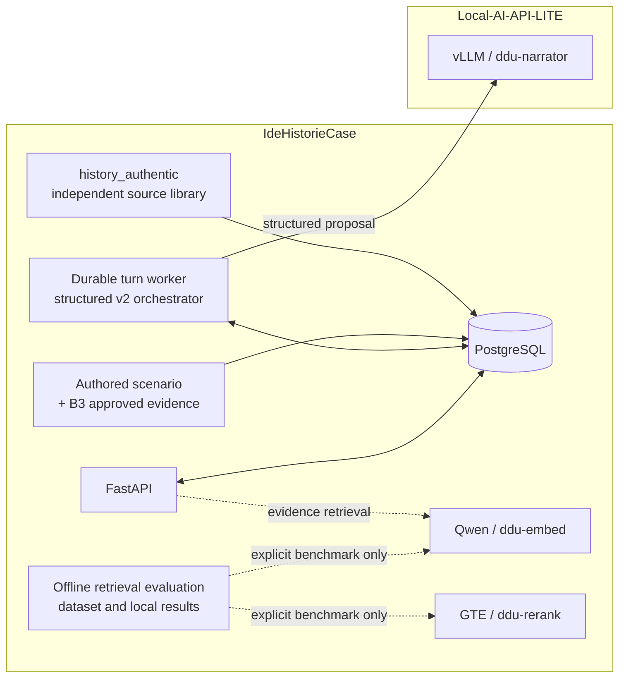

# CASES architecture and data boundaries

CASES is the application repository. It owns the API, PostgreSQL schema, scenario versions, durable validated turns, evidence policy, and import/evaluation tooling. Model serving and model files belong to the separate [Local-AI-API-LITE repository](https://github.com/MarcusFunt/Local-AI-API-LITE).

## Three data planes

1. **Scenario and game evidence.** Authored scenario releases are immutable and sessions pin one version. B3 stores scenario-specific historical passages and review history. A passage can be returned to a session only when the current review and rights status are approved and the scenario, actor, world date, and evidence policy allow it. The checked-in Versailles passages remain pending; search returns `RAG_NO_EVIDENCE` until an operator completes review.
2. **Authentic source library.** Danmarks Breve data is imported into the separate `history_authentic` schema as an immutable, checksummed library. It is not joined to B3 search and import does not approve passages for any scenario. The full source archive and release bundle stay outside Git.
3. **Offline evaluation.** The bilingual Versailles retrieval dataset, judgments, traces, and resource measurements belong to the evaluation harness. Generated runs stay outside Git. The current dataset has 40 reviewed pilot queries and 0 of 100 held-out queries; its status remains `draft`, so it supports no held-out acceptance claim.

## Runtime ownership

The backend Compose project owns `postgres`, `migrate`, `api`, and `turn-worker`. PostgreSQL joins only the backend data network. The API and turn worker join the private external `ddu_inference_bus`; the API calls `ddu-embed` for historical retrieval, and the worker calls the narrator for structured v2 proposals. The application validates each proposal and fences commits with renewable request leases. Reranking is optional and disabled by default. Cases never starts, stops, downloads, or configures Local-AI-API-LITE services.

The migration graph is linear through `0013_turn_repair_budget`; it adds a durable, one-use structured repair budget to turn requests.

See [B3_RAG_RUNBOOK.md](B3_RAG_RUNBOOK.md), [HISTORY_CORPUS.md](HISTORY_CORPUS.md), [RETRIEVAL_EVALUATION.md](RETRIEVAL_EVALUATION.md), and [SHARED_INFERENCE.md](SHARED_INFERENCE.md) for the operational boundaries.
